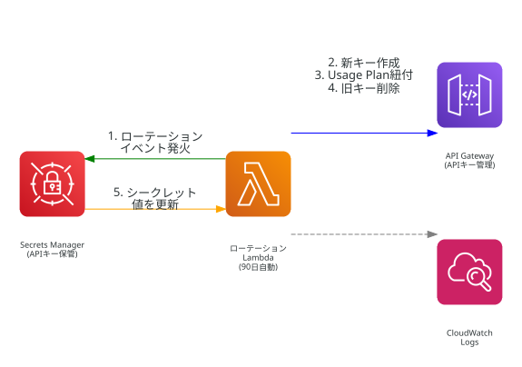
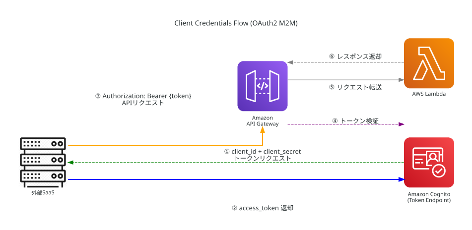

# APIキーローテーション設計書

## 概要

ワークフロー連携用APIキー（`/workflow/analyze`）の自動ローテーション機能。
AWS Secrets Manager + ローテーションLambda の標準パターンで実装。

## なぜローテーションが必要か

- APIキーは長期間固定の文字列であり、漏洩リスクが蓄積する
- 退職者やプロジェクト異動者がキーを知っている可能性
- 定期的な自動ローテーションで漏洩時の影響を最小化

## アーキテクチャ



## ローテーションフロー（4ステップ）

Secrets Managerのローテーションは以下の4ステップで実行される:

### Step 1: createSecret
1. Secrets Managerに新バージョン（AWSPENDING）を作成
2. API Gatewayで新しいAPIキーを生成
3. 新キーのID・値をAWSPENDINGとして格納

### Step 2: setSecret
1. 新APIキーをUsage Planに紐付け
2. この時点で**新旧両方のキーが有効**（ダウンタイムなし）

### Step 3: testSecret
1. 新APIキーが有効（Enabled=true）であることを検証
2. 無効の場合はエラーを発生させ、ローテーションを中断

### Step 4: finishSecret
1. Secrets ManagerのAWSCURRENTを新バージョンに切り替え
2. 旧APIキーのUsagePlanKey紐付けを解除
3. 旧APIキーを削除

## シークレットのJSON構造

```json
{
  "apiKeyId": "xxxxxxxxxx",
  "apiKeyValue": "xxxxxxxxxxxxxxxxxxxxxxxxxxxxxxxxxxxxxxxx",
  "usagePlanId": "xxxxxxxxxx",
  "restApiId": "xxxxxxxxxx",
  "stageName": "prod",
  "resourcePrefix": "image-analysis-api"
}
```

## ローテーション間隔

- **90日**（`AutomaticallyAfterDays: 90`）
- Secrets Managerが自動でローテーションLambdaを呼び出す

## 手動ローテーション実行

即座にローテーションを実行したい場合:

```bash
aws secretsmanager rotate-secret \
  --secret-id <SECRET_ARN> \
  --region ap-northeast-1
```

## 現在のAPIキー値の取得

```bash
aws secretsmanager get-secret-value \
  --secret-id <SECRET_ARN> \
  --region ap-northeast-1 \
  --query 'SecretString' \
  --output text | python3 -c "import sys,json; print(json.load(sys.stdin)['apiKeyValue'])"
```

## ワークフロー側の推奨実装（将来対応）

mail-backendのワークフローからAPIキーを使用する場合の実装例。

### Python実装例

```python
import boto3
import json

sm = boto3.client('secretsmanager')
secret = json.loads(
    sm.get_secret_value(
        SecretId='image-analysis-api/api-key'
    )['SecretString']
)
api_key = secret['apiKeyValue']

import requests
response = requests.post(
    'https://<api-gateway-domain>/prod/workflow/analyze',
    headers={
        'Content-Type': 'application/json',
        'x-api-key': api_key,
    },
    json={
        'data': '<base64画像>',
        'target': '人物',
    }
)
```

### キャッシュ実装例

頻繁なSecrets Manager呼び出しを避けるため、キャッシュを推奨:

```python
import time

_cache = {'value': None, 'expires': 0}
CACHE_TTL = 3600  # 1時間

def get_api_key(secret_id: str) -> str:
    if _cache['value'] and time.time() < _cache['expires']:
        return _cache['value']
    sm = boto3.client('secretsmanager')
    secret = json.loads(
        sm.get_secret_value(SecretId=secret_id)['SecretString']
    )
    _cache['value'] = secret['apiKeyValue']
    _cache['expires'] = time.time() + CACHE_TTL
    return _cache['value']
```

### IAM権限

呼び出し側（mail-backend Lambda）に必要なIAMポリシー:

```json
{
  "Effect": "Allow",
  "Action": "secretsmanager:GetSecretValue",
  "Resource": "<ApiKeySecret ARN>"
}
```

## トラブルシューティング

| 症状 | 原因 | 対処 |
|------|------|------|
| ローテーション失敗 | Lambda権限不足 | CloudWatch Logsでエラー確認、IAMポリシー見直し |
| 新キーが使えない | setSecretでUsagePlanKey未作成 | 手動で再ローテーション実行 |
| 旧キーが残存 | finishSecret途中失敗 | AWS CLIで旧キーを手動削除 |
| シークレット値がPLACEHOLDER | 初回ローテーション未実行 | 手動ローテーション実行 |

## 外部サービス連携時の認証方式

現在の実装はAWS内部（mail-backend等）からのアクセスを前提としている。AWS外の外部サービス（SaaS等）からアクセスする場合は、別途認証方式の検討が必要。

### 解決パターン一覧

| パターン | 方式 | 概要 | 適用場面 |
|---------|------|------|---------|
| A. 通知 + 手動更新 | SNS → メール/Slack通知 | ローテーション完了時に管理者に通知、手動で外部SaaS設定を更新 | 連携先が少数（1〜3件） |
| B. Webhook自動配信 | finishSecretでコールバック | ローテーション完了時に外部SaaSのキー更新APIを自動呼び出し | 外部SaaS側にキー更新APIがある場合 |
| C. IAM認証 | IAMクレデンシャル | 外部サービスにIAM Access Key/Secret Keyを発行し、Secrets Managerから直接キー取得 | 外部サービスがAWS上にある場合 |
| D. Cognito Client Credentials | OAuth2 client_id + client_secret | 外部サービスにCognitoアプリクライアントを発行、トークン認証でAPIアクセス | 一般的な推奨（後述） |

### 一般的な推奨: パターンD（Cognito Client Credentials）

多くのSaaSが採用している「アクセスキー＋シークレットキー」方式は、OAuth2 Client Credentialsフローそのものである。

- `client_id` = アクセスキー
- `client_secret` = シークレットキー

外部サービスはこのペアでCognitoからアクセストークンを取得し、APIを呼び出す。



**パターンDが推奨される理由:**

1. **APIキーのローテーション問題が発生しない** — Cognitoがトークンのライフサイクルを管理するため、Secrets Manager + ローテーションLambdaが不要
2. **認証とレート制限を統一管理** — API Gatewayのスロットリング設定でレート制限も対応可能
3. **不明な外部アクセスの遮断** — 有効なclient_id/client_secretを持たない呼び出しはトークン取得不可。APIキーと同等のアクセス制御を実現
4. **業界標準** — Stripe、SendGrid、Twilio等の主要SaaSと同じ認証パターン

### コスト比較

| 項目 | 現状（APIキーローテーション） | D一本（Client Credentials） |
|------|---------------------------|---------------------------|
| Secrets Manager | $0.40/月（固定） | 不要 |
| ローテーションLambda | ≈$0 | 不要 |
| Cognito M2M トークンリクエスト | — | $2.25/1,000リクエスト（$0.00225/リクエスト） |
| Cognito M2M アプリクライアント料金 | — | 無料（2025/11撤廃済み） |
| M2M無料枠 | — | なし |

**月間リクエスト数別コスト:**

| 月間リクエスト数 | 現状（APIキーローテーション） | D一本（Client Credentials） |
|----------------|---------------------------|---------------------------|
| 100 | $0.40 | $0.23 |
| 200 | $0.40 | $0.45 |
| 1,000 | $0.40 | $2.25 |
| 10,000 | $0.40 | $22.50 |

現状のAPIキーローテーション（Secrets Manager $0.40/月固定）は、月178リクエスト以上でD一本より安くなる。パターンDの推奨理由はコストではなく、認証アーキテクチャの堅牢性と運用の簡素化にある。トークンキャッシュ（TTL設定）により実際のリクエスト数を大幅に削減できるため、キャッシュ実装が前提となる。

### 本プロジェクトの位置づけ

本プロジェクトでは学習目的でAPIキーローテーション（Secrets Manager + ローテーションLambda）を実装した。本番で外部サービス連携を本格的に行う場合は、Cognito Client Credentialsへの移行を推奨する。

移行時の変更点:
- `api/template.yaml` に ResourceServer + 外部SaaS用 UserPoolClient を追加
- `/workflow/analyze` の認証をCognito Authorizerに変更
- Secrets Manager + ローテーションLambda関連リソースを削除

## テスト画面への影響

**なし。** テスト画面（`POST /api/analyze`）はCognito JWT認証を使用しており、APIキーは使用しない。
