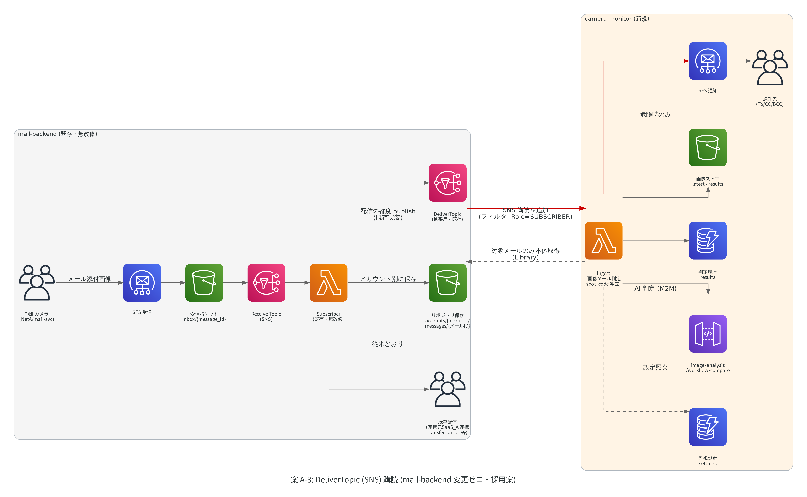
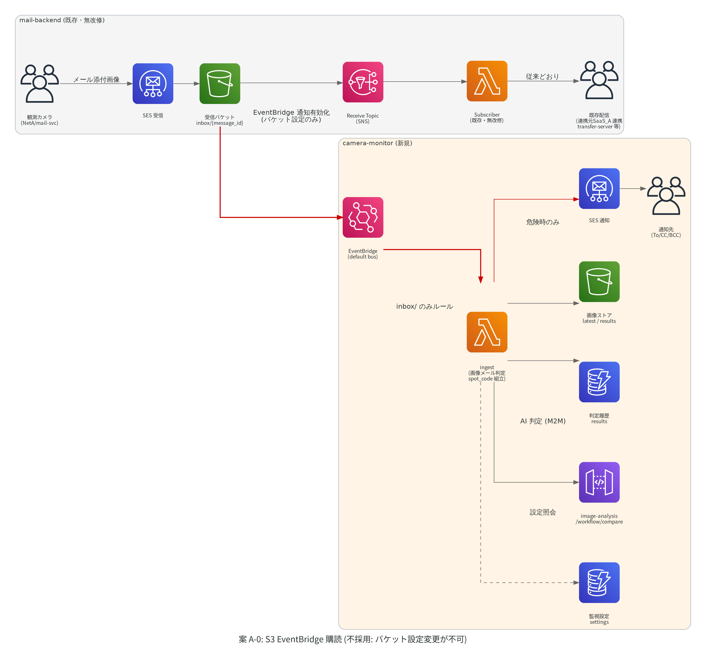
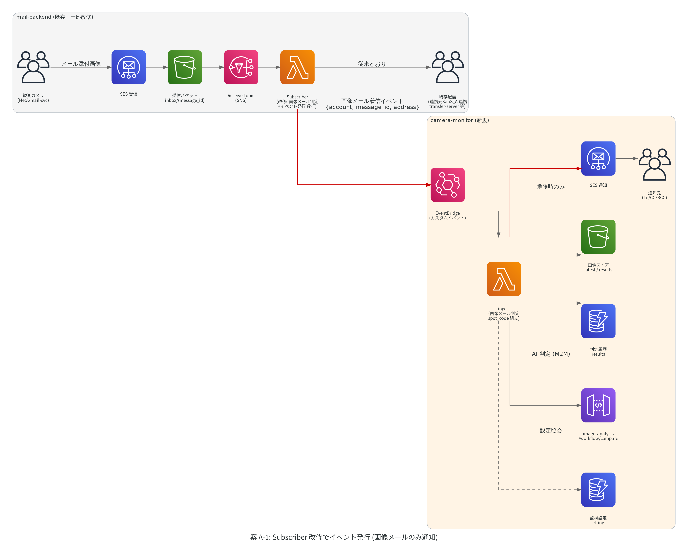
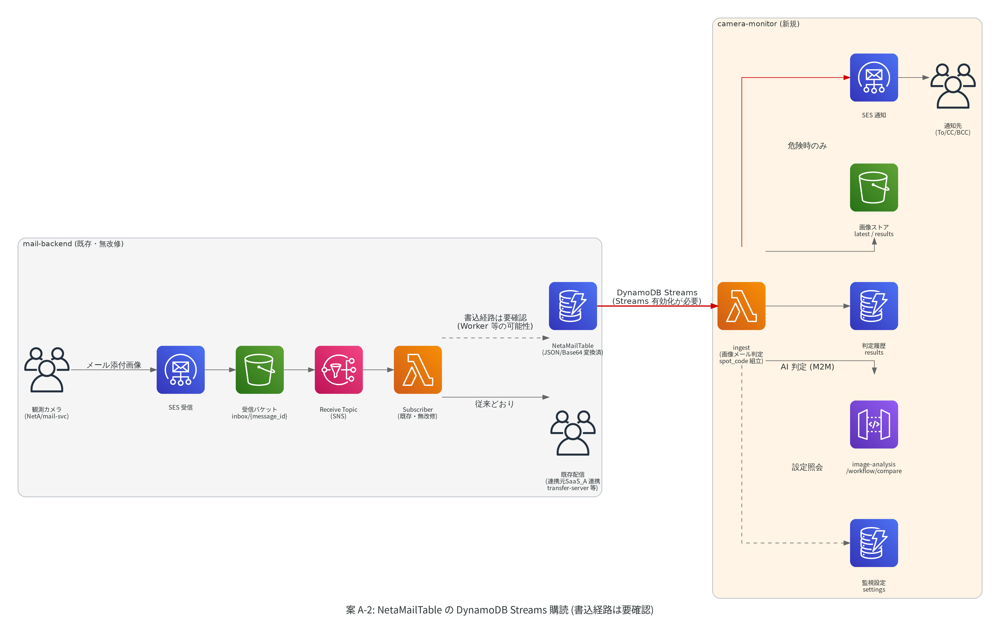

# camera-monitor 着信フック方式比較 (A-0 / A-1 / A-2 / A-3)

| 項目 | 内容 |
|------|------|
| ドキュメント名 | CAMERA-MONITOR-HOOK-COMPARISON_フック方式比較.md |
| バージョン | v1.1 |
| 作成日 | 2026-07-14 |
| 作成者 | 弊社 開発部 |
| 関連チケット | redmine-dev #4658 |
| 親ドキュメント | CAMERA-MONITOR-CONCEPT_構想設計.md (§6) |

> **本書の位置づけ**: カメラ画像の着信を検知する「フック」の 4 方式を、アーキテクチャ図・かみ砕き説明・コスト試算付きで比較し、採用判断を記録する。

---

## 1. 結論

**案 A-3 (既存 DeliverTopic (SNS メール配信トピック) の購読) を採用する** (2026-07-16 変更決定)。

- 一次決定していた案 A-0 (受信 S3 バケットの EventBridge 通知購読) は、mail-backend 管理側より**「受信バケットの設定変更は不可」との回答**を受け不成立となった
- 代わりに先方から提示されたのが DeliverTopic の購読。mail-backend が**配信の都度、既に publish している拡張システム向けの SNS トピック**で、こちらは購読を 1 本追加するだけ。**mail-backend 側はコード・設定とも変更ゼロ** (A-0 で必要だったバケット設定の変更すら不要)
- メッセージにはメール ID を含む永続保存先キー (`accounts/{アカウント}/messages/{メールID}`) と送信元の属性が入っており、解析ライブラリ (mail_backend Library / example-powertools-python) もコードベースに既存 (§2.2)
- コストは A-0 より安い: SNS の Lambda 配信は無料で、対象外メールの判別に S3 アクセスも不要 → **月 100 万通で約 $0.6 (約 100 円)** (§5)
- 将来メール件数が桁で増えた場合の A-1 への移行パスは従来どおり維持する (§7)

## 2. 前提: mail-backend 受信実装と拡張の口 (実ソース調査)

### 2.1 受信経路 (2026-07-14 確認)

カメラ画像を含むすべての受信メールは、次の経路で処理されている:

```
カメラ → メール送信 → SES 受信 → S3 受信バケットに保存 (キー: inbox/{message_id})
  → SNS (ReceiveTopic) → Subscriber Lambda → 各アカウントへ配信 (accounts/{アカウント}/messages/ へ保存)
  → 連携元SaaS_A 連携 (transfer-server 等)
```

### 2.2 拡張システム向けの口 = DeliverTopic (2026-07-16 確認)

Subscriber Lambda は受信メールの配信処理のたびに、**DeliverTopic という SNS トピックへ publish している** (Subscriber/code/app.py の `topic.publish(...)`)。これは外部の拡張システムへ着信を知らせるための既設の口で、Library のコード内コメントにも拡張システム (ExpansionSystem) からの利用例が明記されている。

DeliverTopic メッセージの内容 (Library/mail_backend/data/sub/topic.py で確認):

- S3 イベント通知と同形式の JSON。ただしキーは `inbox/{message_id}` (**配信直後に削除される一時領域**) ではなく、**永続保存先の `accounts/{アカウント}/messages/{メールID}` に置換済み** → 購読側は削除と競合せずにメール本体を取得できる
- SNS メッセージ属性に `Role` (PUBLISHER=送信 / SUBSCRIBER=受信) と `Source` (送信元アドレス) が付与済み → **購読側のフィルタポリシーだけで受信メールに絞れる**
- 解析は既存ライブラリがそのまま使える: `DeliverTopic.parse(event)` で解析し、`topic.account` (宛先アカウント) / `topic.message` (MIME 解析済みメール本体、添付含む) を参照する

なお `inbox/*` が配信直後に削除される仕様は今回の調査で判明した。A-0 を採用していた場合、生メールの取得が削除と競合するリスクへの対策が別途必要だった。

## 3. 4 案のかみ砕き説明

### 案 A-3: DeliverTopic (SNS) 購読 — 「配達完了の館内放送を聞く」(採用)



- **たとえ**: 郵便の仕分け担当 (Subscriber) は、配達を終えるたびに「◯◯さん宛の郵便を配達しました。保管場所はここです」という館内放送 (DeliverTopic) を**今も流し続けている**。こちらはその放送の受信機 (ingest) を 1 台置くだけ。放送を流す側には何の変更もない
- 購読にはフィルタポリシー (Role=SUBSCRIBER) を付け、受信メールの放送だけを聞く。ingest は放送内のキーから宛先アカウントを読み取り、監視対象でなければ S3 に触れず即終了する
- 監視対象のメールだけ、既存 Library (`topic.message`) でメール本体 (添付画像含む) を取得して判定フローへ進む
- 既存の防災経路 (ReceiveTopic → Subscriber → 配信) には影響しない (既設トピックへの追加購読は他の購読者と独立)
- 実装前の確認事項: camera-monitor 側 Lambda からの購読可否 (同一 AWS アカウントなら追加設定不要 / クロスアカウントならトピックポリシーへの購読許可 1 点を先方に依頼)、mail_backend Library・example-powertools-python レイヤの利用方法

### 案 A-0: S3 EventBridge 購読 — 「郵便受けを外から見張る」(不採用)



- **不採用 (2026-07-16)**: mail-backend 管理側より、受信バケットの設定変更 (EventBridge 通知の有効化) は不可との回答。加えて `inbox/*` は配信直後に削除されるため (§2.2)、生メール参照が削除と競合するリスクも判明した
- **たとえ**: 郵便受け (S3) に手紙が入った瞬間、AWS が「入りましたよ」と教えてくれる標準サービス (EventBridge) を購読する。郵便屋さん (mail-backend) の仕事のやり方には触らないが、**郵便受けに通知装置を付ける工事 (バケット設定変更) が必要**で、ここが受け入れられなかった
- 受信バケットの「EventBridge 通知」を有効化し、camera-monitor 側の ingest Lambda が全メールの着信通知を受けて画像メールかどうかを自分で判定する想定だった

### 案 A-1: Subscriber 改修でイベント発行 — 「仕分け担当に一声かけてもらう」



- **たとえ**: 郵便の仕分け担当 (Subscriber Lambda) に「写真入りの封筒が来たら、こちらにも一声かけて」とお願いする。声かけは正確 (画像メールだけ通知) だが、**仕分け担当の作業手順書 (mail-backend のコード) に手を入れる**必要がある
- 改修は数行 (画像メール判定 + EventBridge へカスタムイベント発行) だが、防災システムの受信パスに触るため、mail-backend 側のテスト・リリース計画に乗る必要がある = こちらのペースで進められない
- 起動が画像メールに限定されるため無駄撃ちゼロ。メール件数が桁で増えた場合の移行先

### 案 A-2: NetaMailTable の DynamoDB Streams 購読 — 「台帳の書き込みを見張る」



- **たとえ**: 仕分け済みメールの台帳 (NetaMailTable) に新しい行が書かれた瞬間を見張る (DynamoDB Streams)。台帳には**翻訳済み (JSON/Base64 変換済み) のデータ**が載っているので、読み取る側は楽
- ただし「誰がいつ台帳に書くのか」(Subscriber か Worker か)、「画像の本体が台帳に載るのか、別置きなのか」(DynamoDB は 1 項目 400KB 制限があるため S3 参照の可能性大) が**未確認**。裏取り調査をしてからでないと成立可否が判断できない
- Streams の有効化はテーブル設定変更 (コード変更なし) だが、mail-backend のテーブルに対する設定変更である点は A-0 のバケット設定と同格 (= 同じ理由で不可となる可能性が高い)

## 4. 比較表

| 観点 | A-3: DeliverTopic 購読 (採用) | A-0: S3 EventBridge (不採用) | A-1: Subscriber 改修 | A-2: DynamoDB Streams |
|---|---|---|---|---|
| mail-backend のコード改修 | **なし** | なし | あり (数行 + テスト・リリース) | なし |
| mail-backend 側の設定変更 | **なし** (購読はこちら側の操作。クロスアカウント時のみ購読許可 1 点) | バケットの EventBridge 通知有効化 → **不可回答** | なし | テーブルの Streams 有効化 (同じく不可の可能性大) |
| こちらのペースで進められるか | **◎ 完全に独立** | ✗ 設定変更が不可で不成立 | ✗ 先方のリリース計画に依存 | △ 裏取り調査 + 設定変更許可が必要 |
| ingest の起動対象 | **受信メールのみ** (Role 属性フィルタ、無料) | 全受信メール + 全オブジェクト作成 | 画像メールのみ | NetaMailTable への書込のみ |
| データ形態 | **永続キー + Library で解析済みメール取得** (削除と競合しない) | 生メール (MIME)。inbox/ は配信直後に削除され競合リスク | イベント (account 等) + S3 から取得 | JSON/Base64 変換済み (画像本体の所在は要確認) |
| リアルタイム性 | ◎ 配信処理直後 | ◎ S3 保存直後 | ◎ 配信処理直後 | ○ 書込直後 (書込タイミング未確認) |
| 既存防災経路への影響 | **なし** (既設トピックへの追加購読) | なし (物理的に別経路) | 受信パスに追加コード | なし (設定のみ) |
| 月額コスト目安 (100 万通/月) | **約 $0.6 (§5)** | 約 $1.2 | ほぼ $0 (画像のみ起動) | ほぼ $0 (Streams の Lambda 読取は無料) |
| 主なリスク | 購読許可・レイヤ利用の事前確認 (小) | 設定変更不可で不成立 | 防災システム改修のリスクと調整コスト | 前提未確認 (書込経路・画像所在) + 設定変更許可 |

## 5. 案 A-3 のコスト試算

**料金出典: AWS Pricing MCP (ap-northeast-1。SNS は 2026-07-16、Lambda は 2026-07-10 取得)**

| 項目 | 単価 | 根拠 |
|---|---|---|
| SNS → Lambda 配信 | **$0 (無料)** | APN1-DeliveryAttempts-LAMBDA = $0 ("There is no charge for Lambda Notifications") |
| SNS フィルタポリシー (属性ベース) | **$0 (無料)** | 課金があるのはペイロードベースのフィルタのみ ($0.13/GB)。Role 属性での絞り込みは無料 |
| SNS publish | 追加コストなし | DeliverTopic への publish は既存処理で発生済み (こちらが購読しても増えない) |
| Lambda リクエスト | $0.20/100 万件 | 2026-07-10 MCP 取得 (COST-ESTIMATE.md と同一) |
| Lambda 実行時間 | $0.0000166667/GB 秒 | 同上 |

試算条件: Role=SUBSCRIBER フィルタで受信メール分のみ配信。対象外メールはメッセージ内のキーから宛先アカウントを読み、監視対象集合 (メモリキャッシュ) と照合して即終了 = **S3 アクセス不要**、約 100ms・256MB (0.025 GB 秒/件)。

| 月間受信メール数 | Lambda リクエスト | Lambda 実行時間 | SNS | **合計/月** |
|---|---|---|---|---|
| 10 万通 | $0.02 | $0.04 | $0 | **約 $0.06 (約 10 円)** |
| 100 万通 | $0.20 | $0.42 | $0 | **約 $0.6 (約 100 円)** |
| 1,000 万通 | $2.00 | $4.17 | $0 | **約 $6.2 (約 960 円)** |

- 円換算は 155 円/USD。Lambda 無料枠 (100 万リクエスト + 40 万 GB 秒/月、アカウント全体で共有) が残っていれば実費はさらに下がる
- 参考: 不採用の A-0 は Ranged GET での判別が必要だったため月 100 万通 ≈ $1.2 (v1.0 試算)。A-3 は判別に S3 アクセスが不要な分、約半額になる
- 画像メール本体の処理 (メール本体取得 + 判定 + 保存) はカメラ台数×送信回数分だけ発生するが、これは全案共通のコスト (支配的なのは AI 判定費用。COST-ESTIMATE.md 参照)
- **実際の月間受信数の実測方法**: CloudWatch で Subscriber Lambda の Invocations (月合計) を見るのが最も簡単

## 6. 無駄撃ちを抑える実装の工夫 (案 A-3)

1. **購読のフィルタポリシーで `Role=SUBSCRIBER` (受信) に限定** — 送信 (PUBLISHER) の publish では起動しない。属性ベースのフィルタは無料
2. **宛先アカウントはメッセージ内のキーから取得** (`accounts/{アカウント}/messages/{メールID}`) — S3 に触れずに判別できる
3. **監視対象アカウントの集合を Lambda メモリにキャッシュ** (設定テーブルから 5 分 TTL で再読込) — 監視対象外の通信機アカウント宛メールは DynamoDB を引かずに即終了
4. キーが `accounts/` 形式でないメッセージ (宛先アカウント無しの特殊ケース) はスキップ
5. 監視対象のときだけ Library (`topic.message`) でメール本体を取得 → 画像添付を確認 → spot_code 組立 → 判定フローへ進む

## 7. 将来の移行パス

フックは構想設計の「ingest 1 インターフェース (縫い目)」の裏側にあるため、フック方式を変えても UI・DB・判定フローは一切変わらない。

- A-3 は受信メールの件数分だけ ingest が起動する。月間数千万通級になり Lambda 費用や同時実行数が問題になった場合は、A-1 (Subscriber へ画像メール判定 + イベント発行を数行追加) を mail-backend 側に依頼し、購読先をカスタムイベントに切り替える
- A-2 (NetaMailTable の Streams) は書込経路・画像所在の裏取りができれば代替になり得るが、テーブル設定変更が必要な点で A-0 と同じ壁があるため、調査は保留のまま

---

## 改訂履歴

| バージョン | 日付 | 改訂内容 |
|---|---|---|
| v1.0 | 2026-07-14 | 初版。受信実装の実確認 (SES→S3 inbox/→SNS→Subscriber) を前提に 3 方式を図・かみ砕き説明・コスト試算付きで比較し、案 A-0 (S3 EventBridge 購読) の採用を記録。料金は AWS Pricing MCP (2026-07-14) で裏取り |
| v1.1 | 2026-07-16 | mail-backend 管理側の回答 (受信バケットの設定変更は不可) を受け、案 A-0 を不採用に変更。先方提示の**案 A-3 (既存 DeliverTopic (SNS) の購読) を追加・採用**。DeliverTopic の実装 (メール ID 入り永続キーへの置換・Role/Source 属性・解析ライブラリ・inbox/ 即時削除) を実ソース確認し、アーキ図 (hook-a3.png) とコスト試算 (SNS の Lambda 配信無料 = Pricing MCP 2026-07-16 裏取り、月 100 万通 ≈ $0.6) を追加 |
