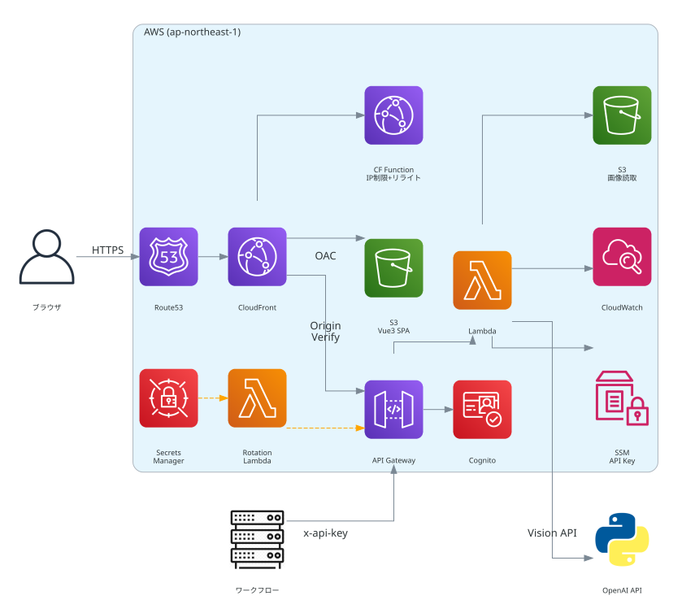
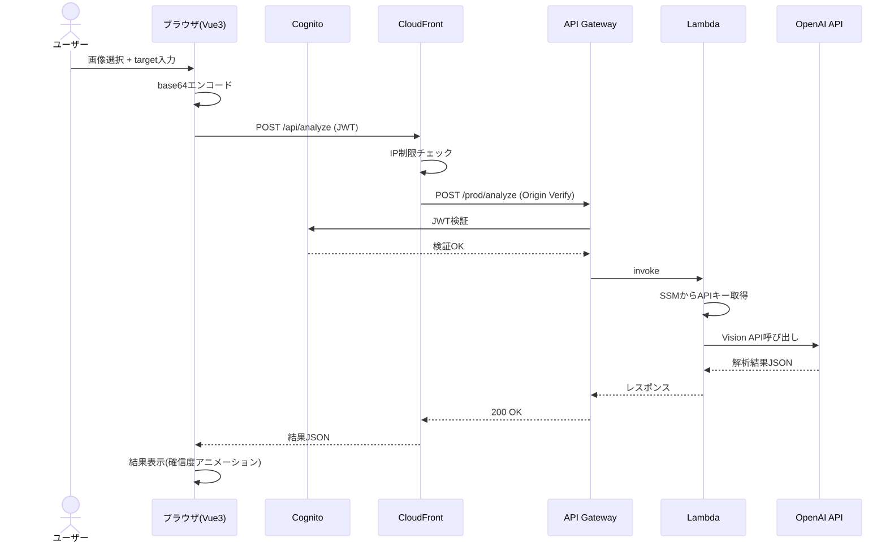
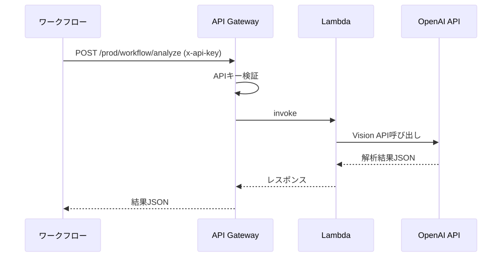
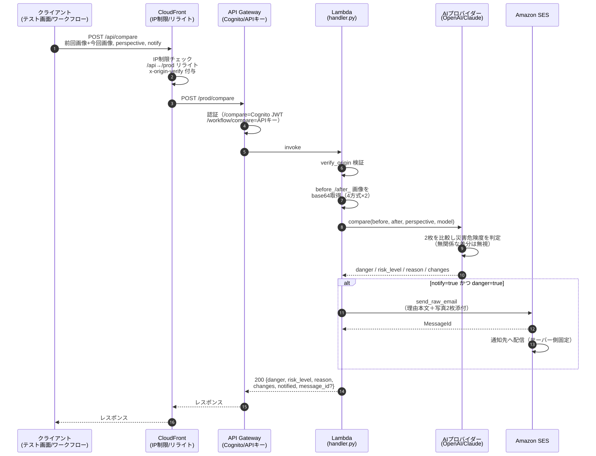

# アーキテクチャ設計書

## システム全体構成図

## データフロー図

### テスト画面経路

### ワークフロー経路

## シーケンス図

### テスト画面からの解析リクエスト

### ワークフローからの解析リクエスト

### 画像比較（災害差分監視）と危険時メール通知

前回画像・今回画像の2枚をAIで比較し、監視観点に基づき災害危険度を判定する。`notify=true` かつ危険判定（`danger=true`）のときのみ、理由と写真2枚を添付したメールを送信する（宛先は `notify_to`/`notify_cc`/`notify_bcc` で指定可、省略時はサーバー既定 `NOTIFY_RECIPIENTS`）。さらに `notify_line=true` の場合は LINE Messaging API でも通知する（テキスト＋画像2枚、画像は専用S3バケットの presigned URL で送信）。

## コンポーネント一覧

| コンポーネント | 種別 | 説明 |
|--------------|------|------|
| CloudFront | CDN | 静的配信 + APIプロキシ + IP制限 |
| CloudFront Function | Edge | IPホワイトリスト + /api→/prod リライト |
| S3 Bucket | Storage | Vue3 SPAホスティング |
| S3 Bucket (LINE画像) | Storage | LINE通知用の画像を一時保管（非公開・AES256・7日で自動削除、presigned URLで配信） |
| API Gateway (REST) | API | RESTエンドポイント、認証統合 |
| Cognito User Pool | Auth | テスト画面ユーザー認証 |
| Lambda | Compute | 画像解析・画像比較ハンドラ (Python 3.12) |
| AI プロバイダー層 | Compute | Amazon Bedrock Claude / Amazon Bedrock GPT / Claude Platform on AWS をモデルIDの名前空間でルーティングしてAI推論（IAM/SigV4、APIキー不要）(analyzer.py) |
| 通知モジュール | Compute | 危険検知時のメール送信 (notifier.py, SES) + LINE Messaging API push（画像はpresigned URL） |
| SES + Route53 DKIM | Notify | 添付付きメール通知（送信ドメイン検証） |
| LINE Messaging API | Notify | 危険検知時のLINE push通知（テキスト＋画像2枚、任意） |
| SSM Parameter Store | Secret | オリジン検証シークレット・LINEチャネルアクセストークン保管 |
| Route53 | DNS | カスタムドメイン管理 |
| ACM | Cert | SSL/TLS証明書 |
| CloudWatch Logs | Monitor | ログ収集・監視 |
| Secrets Manager | Secret | APIキーの安全な保管・自動ローテーション |
| ローテーションLambda | Compute | APIキーの90日自動ローテーション |

## AI推論経路

`analyzer.py` の `get_analyzer()` がモデルIDの名前空間で次の3経路を選択する。既定モデルは Amazon Bedrock Claude の `anthropic.claude-sonnet-5`。いずれも Lambda 実行ロールの IAM 認証（SigV4）を用い、AIサービス用のAPIキーは不要である。

| モデルID | 経路 | API | 処理リージョン |
|----------|------|-----|---------------|
| `anthropic.claude-*` | Amazon Bedrock Claude | Messages API（`bedrock-mantle.{region}.api.aws/anthropic/v1/messages`） | Haiku 4.5 / Opus 4.7 / Opus 4.8: 東京、Sonnet 5: 米国東部（東京未提供） |
| `openai.gpt-*` | Amazon Bedrock GPT | Responses API（`bedrock-mantle.{region}.api.aws/openai/v1/responses`、`store:false`） | 米国東部（Ohio） |
| プレフィックスなしの `claude-*` | Claude Platform on AWS（CPoA） | Anthropic Messages API | 米国 |

## 技術スタック

| レイヤー | 技術 | バージョン |
|---------|------|-----------|
| フロントエンド | Vue 3 (Composition API) | 3.x |
| UI | Vuetify 3 | 3.x |
| 認証UI | @aws-amplify/ui-vue | latest |
| ビルド | Vite | 6.x |
| バックエンド | Python | 3.12 |
| AI SDK | anthropic[aws]（CPoA / Bedrock Claude）+ botocore（Bedrock GPT SigV4） | latest |
| メール通知 | Amazon SES（boto3 send_raw_email） | - |
| IaC | AWS SAM / CloudFormation | - |
| テスト | pytest / Vitest / Playwright | - |
| CI/CD | SAM CLI | 1.154+ |
