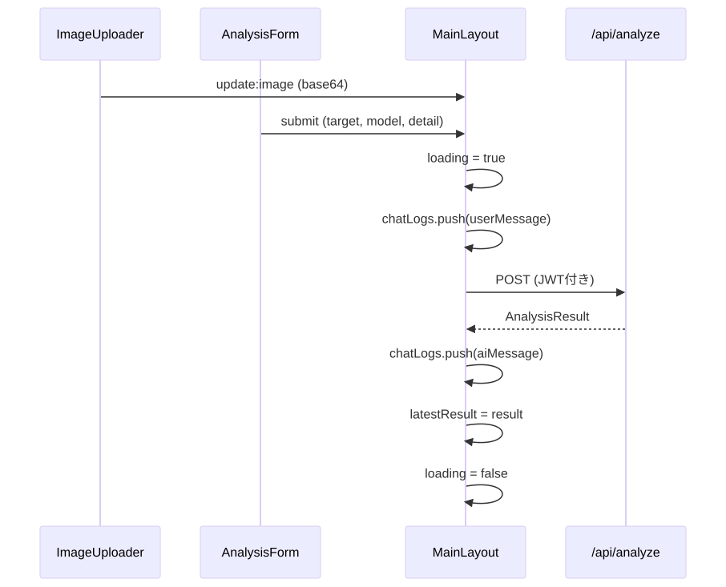

# フロントエンド設計書

## 画面遷移図



## コンポーネント構成図



## 画面モード（タブ構成）

`App.vue` が `v-tabs` / `v-window` でモードを切り替える（`mode: 'single' | 'compare'`）。

| タブ | モード | 主なコンポーネント |
|------|--------|-------------------|
| 単一画像解析 | single | ImageUploader / AnalysisForm / AnalysisResult / ChatLog |
| 画像比較（災害差分監視） | compare | ImageUploader×2（前回/今回） / CompareForm / CompareResult / 比較履歴 |

## コンポーネント一覧

| コンポーネント | 責務 | 主要Props | Events |
|--------------|------|----------|--------|
| App.vue | ルート、Amplify認証、タブ制御、`/api/analyze`・`/api/compare` 呼び出し | - | - |
| AppHeader.vue | ヘッダー、ユーザー名、サインアウト | user, signOut | - |
| ImageUploader.vue | D&D/クリック画像入力、プレビュー。`title` prop で見出しを切替（前回/今回）。プレビューに拡大ボタン（ImageLightbox連携） | title | update (base64, preview) |
| AnalysisForm.vue | target/model入力、プラットフォーム別にグループ化したモデル選択、解析ボタン | loading, hasImage | analyze |
| AnalysisResult.vue | 単一解析結果表示 (found/confidence) | found, confidence | - |
| ChatLog.vue | 解析履歴一覧 | entries | - |
| CompareForm.vue | perspective/model/notify入力、プラットフォーム別にグループ化したモデル選択、比較ボタン。notify ON時に To/CC/BCC 入力欄（カンマ区切り）と「LINE通知（画像付き）」チェックを表示 | loading, hasBefore, hasAfter | compare |
| CostPanel.vue | 選択モデルの賢さ（目安）、単価・1リクエスト・監視間隔別月額概算をドル／円で表示 | model, operation | - |
| PlatformInfoDialog.vue | ?ボタンからAIプラットフォームのデータ取り扱い・使い分けを表示 | - | - |
| CompareResult.vue | 比較結果表示（danger/危険度チップ/理由/メール通知状態/LINE通知状態） | result | - |
| ImageLightbox.vue | 画像拡大ダイアログ（v-dialog + v-img）。テンプレートサムネ・アップロードプレビューから起動 | modelValue, src, title | update:modelValue |
| TemplateGallery.vue | テンプレート画像ギャラリー（追加/削除〈削除時は確認ダイアログ〉・localStorage保存・各スロットへ適用・サムネ拡大） | - | apply(dataUrl) 等 |
| UsageGuide.vue | 使い方ステップガイド | - | - |
| SecurityPanel.vue | セキュリティステータスパネル | - | - |
| models.ts | モデル定義、賢さ（目安）、単価、トークンプロファイル、コスト試算（MODELS / DEFAULT_MODEL / estimateCost） | - | - |
| notifications.ts | `parseRecipientList()`（カンマ区切り文字列→trim済みメール配列） | - | - |
| templates.ts | テンプレート画像の localStorage 永続化（キー `image-analysis.templates`） | - | - |

### models.ts（共通定義）

モデル一覧を一元管理する。既定モデルは `DEFAULT_MODEL = 'anthropic.claude-sonnet-5'`（Amazon Bedrock Claude の Sonnet 5）である。`MODELS` は12モデルを `platform`（`bedrock` / `cpoa`）、`provider`（`anthropic` / `openai`）、処理リージョン、入力／出力単価、`intelligence`で定義する。

`AnalysisForm.vue` と `CompareForm.vue` はモデルコンボを「Amazon Bedrock（AWS内完結）」と「Claude Platform on AWS（Anthropic運営）」の subheader でグループ表示する。各選択肢の subtitle には処理リージョンと入力／出力単価（$/1Mトークン）を表示する。Bedrockは `anthropic.claude-*` 5モデルと `openai.gpt-*` 5モデル、CPoAはプレフィックスなしの `claude-*` 3モデルである。

Sonnet 5（Bedrock / CPoA）は2026-09-01から単価を $2/$10 から $3/$15 へ切り替える。`effectivePricing()` が日付に応じた単価を返し、`pricingNote` として切替予定も表示する。解像度（`detail`）は廃止済みで、UI・共通定義には含めない。

`intelligence` は賢さの目安を10点満点・0.5点刻みで表す。最高値は Claude Opus 4.8 の9.5、最低値は Claude Haiku 4.5 の6である。この値は公開ベンチマークと本用途での実測の総合印象による社内目安であり、性能を保証する指標ではない。

### コスト表示

`CostPanel.vue` は先頭行に、`intelligence / 2` を5つ星・半星対応の読み取り専用 `v-rating` と `8.5/10` 形式の数値で表示する。続いてモデルと操作種別に応じた単価、1リクエストあたり、10分間隔監視（月4,320回）、1時間間隔監視（月720回）の概算をドルと円で表示する。為替は `EXCHANGE_RATE_JPY = 155`（155円/USD）を定数として使用する。賢さの表示には社内目安である旨の注記を付ける。

`estimateCost()` の実測トークンプロファイル（1280×720画像）は以下のとおりである。GPTの概算には reasoning トークンを含む。

| プロバイダー | 単一画像解析（入力 / 出力） | 画像比較（入力 / 出力） |
|--------------|-----------------------------|--------------------------|
| Claude | 1,900 / 130 | 3,650 / 250 |
| GPT | 1,400 / 200 | 2,500 / 300 |

### プラットフォーム説明

モデル選択欄の ?ボタンは `PlatformInfoDialog.vue` を開く。ダイアログでは、Amazon BedrockはAWSのセキュリティ境界内で推論が完結し入力データが学習に使われないこと、Haiku / Opus系は東京、Sonnet 5 / GPT系は米国で処理すること、CPoAはAnthropic運営基盤で最新機能・新モデルを早期に利用できることを説明する。機密性の高い画像にはBedrock、最新機能を試す用途にはCPoAを使う目安を示す。

## テーマ・配色

テスト画面はライトテーマで統一する（`main.ts` の Vuetify `defaultTheme: 'light'`）。

| 項目 | 値 |
|------|-----|
| 背景 (background) | `#e1f5fe`（薄い水色） |
| サーフェス (surface) | `#ffffff` |
| primary | `#1976d2` |
| secondary | `#0097a7` |
| success / error | `#2e7d32` / `#d32f2f` |

タブ（`v-tabs`）は `bg-color="surface"`、各 `v-tab` は `color`／`base-color="primary"` を指定し、ライト背景での視認性を確保する。

Vuetify のテーマ変数 `--v-theme-overlay-multiplier` が未定義だと、セレクトの選択項目やタブのオーバーレイが黒背景で表示される不具合があったため、テーマ変数を明示して修正した（`main.ts` の `theme.themes.light.variables` に `overlay-multiplier: 1`、および `style.css` の `.v-theme--light` に `--v-theme-overlay-multiplier: 1`）。

## テンプレート画像ギャラリー

繰り返し使う検証画像を localStorage に保存し、単一解析／比較の各スロットへワンクリックで適用できる。

- 保存先: localStorage キー `image-analysis.templates`（`templates.ts` が `ImageTemplate { id, name, dataUrl }` の配列を JSON 保存）
- 追加/削除: ユーザーが任意に登録・削除。**削除時は確認ダイアログ**を表示（誤操作防止）。1枚あたり **2MB 上限**（超過時「テンプレートは2MB以下の画像にしてください」）。保存容量超過時は追加をロールバックしエラー表示
- 適用: 各テンプレートを単一解析スロット／比較の「前回」「今回」スロットへ適用（`TemplateGallery.vue`）
- 拡大: サムネイルクリック／Enter／Space で `ImageLightbox.vue` により拡大表示

## 画像ライトボックス

`ImageLightbox.vue` は `v-dialog`（`max-width: 90vw`）＋ `v-img`（`max-height: 85vh`, `contain`）で画像を拡大表示する。テンプレートサムネイルとアップロードプレビューの拡大ボタン（`mdi-magnify-plus-outline`）から起動する。props は `modelValue` / `src` / `title`。

## 通知宛先・LINE通知の入力（比較タブ）

比較フォームで `notify` を ON にすると、To／CC／BCC の入力欄（カンマ区切り）と「LINE通知（画像付き）」チェックボックスが表示される。

- To/CC/BCC は `notifications.ts` の `parseRecipientList()` でカンマ分割・trim・空要素除去し、空でないものだけを `notify_to`/`notify_cc`/`notify_bcc`（配列）としてリクエストに付与する（To 未入力時はサーバー既定宛先に送信）
- 「LINE通知」チェック時は `notify_line: true` を付与。サーバー側でLINE設定が未構成の場合はスキップされ、結果は `line_skip_reason` として表示される

## 状態管理

Composition API の `ref` / `reactive` でコンポーネント内管理。Pinia等のストアは不使用（単一画面のため）。

```typescript
// App.vue の主要状態
const mode = ref<'single' | 'compare'>('single')  // タブモード

// 単一画像解析
const imageBase64 = ref('')                        // アップロード画像
const loading = ref(false)                         // 解析中フラグ
const chatLog = ref<ChatEntry[]>([])               // 解析履歴
const latestResult = ref<{ found: boolean; confidence: number } | null>(null)

// 画像比較（災害差分監視）
const beforeBase64 = ref('')                       // 前回画像
const afterBase64 = ref('')                        // 今回画像
const compareLoading = ref(false)
const compareResult = ref<CompareResultData | null>(null)
const compareHistory = ref<CompareHistoryEntry[]>([])
```

### 型定義

```typescript
interface AnalysisResult {
  found: boolean
  context: string
  answer: string
  confidence: number
  model: string
  usage: { prompt_tokens: number; completion_tokens: number; total_tokens: number }
}

interface ChatMessage {
  id: string
  role: 'user' | 'ai'
  content: string
  image?: string        // ユーザーメッセージの場合
  result?: AnalysisResult  // AIメッセージの場合
  timestamp: number
  responseTime?: number // ms
}

// 画像比較の結果（CompareResult.vue）
interface CompareResultData {
  danger: boolean
  risk_level: string          // none | low | medium | high
  reason?: string
  changes?: string
  model?: string
  usage?: Record<string, number>
  elapsed_seconds?: number
  notified?: boolean          // メール通知したか
  message_id?: string         // 通知成功時のMessageID
  notify_error?: string       // メール通知失敗時の理由
  line_notified?: boolean     // LINE通知したか
  line_skip_reason?: string   // LINE未構成でスキップした理由
  line_error?: string         // LINE通知失敗時の理由
}
```

## API呼び出しフロー



## Amplify認証フロー



### Amplify設定

```typescript
Amplify.configure({
  Auth: {
    Cognito: {
      userPoolId: 'ap-northeast-1_XXXXX',
      userPoolClientId: 'XXXXX'
    }
  }
})
```

## ビルド・デプロイ

| 項目 | 値 |
|------|-----|
| ビルドコマンド | `npm run build` |
| 出力ディレクトリ | `frontend/dist/` |
| デプロイ先 | S3 Bucket → CloudFront配信 |
| Amplify設定 | `frontend/src/amplifyconfiguration.ts`（deploy.sh が Cognito Outputs から自動生成、Git管理外） |

> フロントは手動ビルドせず `deploy.sh` に任せる。`deploy.sh` は Amplify 設定（`amplifyconfiguration.ts`）を生成した**後**の Step 4b で `npm run build` を実行してから S3 へ同期する。事前ビルド済み `dist` を同期する旧手順では、別環境（dev）の Cognito 設定が本番バンドルに混入して本番ログイン不能となる事象が発生したため、この順序を厳守する。
