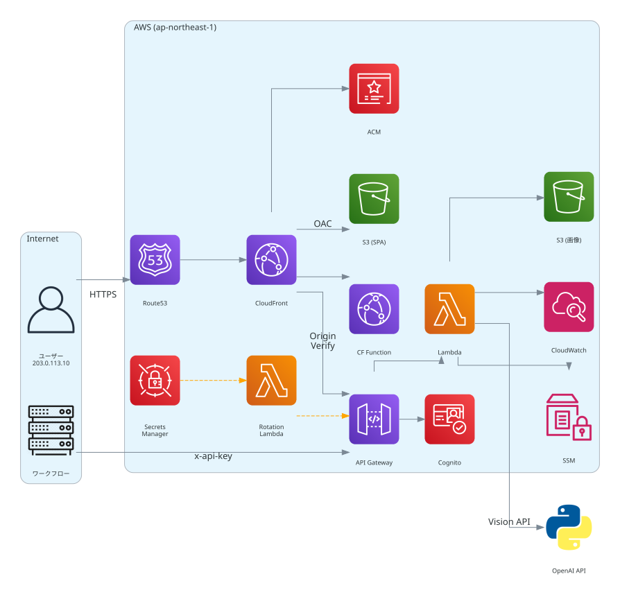
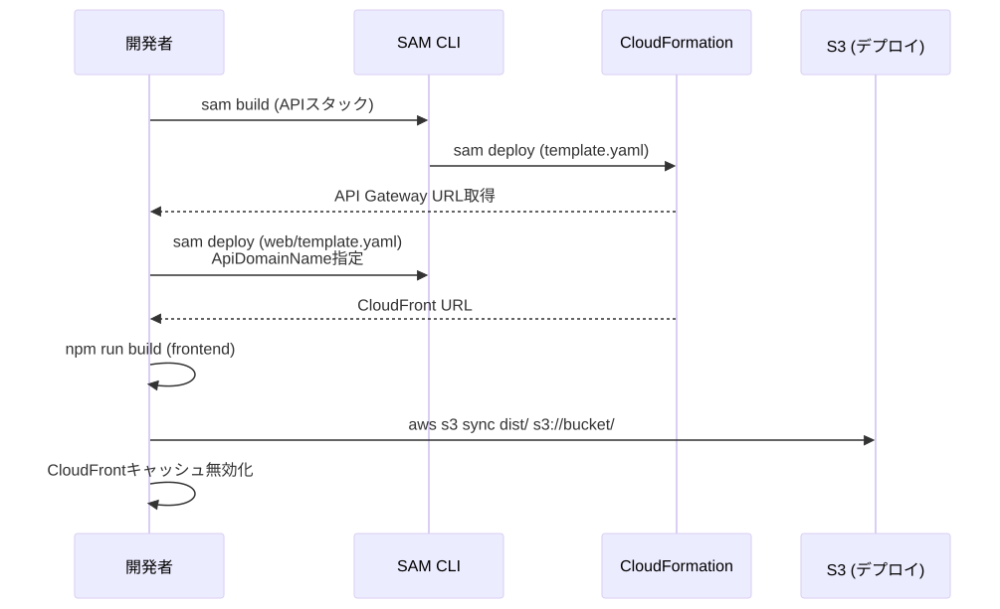

# インフラ設計書

## スタック構成

3テンプレートのネストスタック構成で管理する（mail-backend パターン踏襲）。

| スタック | ファイル | 内容 |
|---------|---------|------|
| 親スタック | template.yaml | ネスト定義、共通パラメータ |
| APIスタック（子） | api/template.yaml | Cognito, Lambda, API Gateway, IAM |
| Webスタック（子） | web/template.yaml | S3, CloudFront, Route53, CloudFront Function |

親スタックから子スタックへは `AWS::Serverless::Application` でパラメータを伝播し、
子スタック間の値受け渡しは `!GetAtt` による自動依存解決で行う。

## APIスタック (api/template.yaml)

### 親スタック (template.yaml) の主要パラメータ

| パラメータ | 型 | デフォルト | 説明 |
|-----------|-----|----------|------|
| SubDomain | String | image-analysis | カスタムURLのサブドメイン |
| BaseDomainName | String | example-cloud.com | カスタムURLのベースドメイン |
| OriginVerifyValue | String | - | オリジン検証シークレット（NoEcho・deploy.sh が SSM から注入） |
| AllowedImageBuckets | String | ""（空=全拒否） | image_bucket 入力を許可するS3バケット（カンマ区切り） |
| AnthropicWorkspaceId | String | ""（デプロイ時に parameter_overrides で注入） | Claude Platform on AWS のワークスペースID（例 `wrkspc_...`） |
| DefaultModel | String | anthropic.claude-sonnet-5 | model 省略時の既定モデル（Amazon Bedrock Claude） |
| LineNotifyTo | String | ""（未設定=LINE通知スキップ） | LINE Messaging API の通知先 userId / groupId |
| NotifyRecipients | String | devA@example.co.jp | 通知メールの既定宛先（カンマ区切り、`notify_to` 省略時に使用） |
| HostedZoneId | String | Z0EXAMPLEZONE0 | Route53 ホストゾーンID（SES DKIM CNAME 登録先） |

親スタックは `SiteOrigin=https://${SubDomain}.${BaseDomainName}`、`SesDomain=${SubDomain}.${BaseDomainName}`、`SesSenderAddress=noreply@${SubDomain}.${BaseDomainName}` を導出してAPIスタックへ伝播する。

### APIスタック (api/template.yaml) パラメータ設計

| パラメータ | 型 | デフォルト | 説明 |
|-----------|-----|----------|------|
| ResourcePrefix | String | - | リソース命名プレフィックス（親スタックから伝播） |
| OriginVerifyHeader | String | x-origin-verify | CloudFront認証ヘッダー名 |
| OriginVerifyValue | String | - | CloudFront認証ヘッダー値（NoEcho） |
| AllowedImageBuckets | String | ""（空=全拒否） | image_bucket 入力を許可するS3バケット（カンマ区切り） |
| SiteOrigin | String | https://image-analysis.example-cloud.com | CORS許可オリジン（ALLOWED_ORIGIN） |
| AnthropicWorkspaceId | String | "" | Claude Platform on AWS ワークスペースID |
| DefaultModel | String | anthropic.claude-sonnet-5 | model 省略時の既定モデル |
| BedrockJpRegion | String | ap-northeast-1 | Bedrock Claude の東京提供モデル用リージョン（`BEDROCK_JP_REGION`） |
| BedrockUsRegion | String | us-east-1 | Bedrock Claude の米国提供モデル用リージョン（`BEDROCK_US_REGION`） |
| BedrockGptRegion | String | us-east-2 | Bedrock GPT 用リージョン（`BEDROCK_GPT_REGION`） |
| LineNotifyTo | String | "" | LINE Messaging API の通知先 userId / groupId |
| SesDomain | String | image-analysis.example-cloud.com | SES送信元ドメイン（DKIM検証） |
| SesSenderAddress | String | noreply@image-analysis.example-cloud.com | 通知メールのFromアドレス |
| NotifyRecipients | String | devA@example.co.jp | 通知先メールアドレス（カンマ区切り） |
| HostedZoneId | String | Z0EXAMPLEZONE0 | Route53 ホストゾーンID（DKIM CNAME登録先） |
| ProjectName | String | image-analysis | プロジェクトタグ |
| LogLevel | String | INFO | Lambdaログレベル |
| ExamplePowertoolsPython | String | - | LambdaレイヤーARN |

### リソース一覧

| リソース | Type | 説明 |
|---------|------|------|
| CognitoUserPool | AWS::Cognito::UserPool | ユーザー認証プール |
| CognitoUserPoolClient | AWS::Cognito::UserPoolClient | SPAクライアント |
| ImageAnalysisFunction | AWS::Serverless::Function | 画像解析Lambda |
| RestApi | AWS::Serverless::Api | REST APIエンドポイント + Cognito Authorizer |
| ApiKey | AWS::ApiGateway::ApiKey | ワークフロー用APIキー |
| UsagePlan | AWS::ApiGateway::UsagePlan | レート制限 |
| UsagePlanKey | AWS::ApiGateway::UsagePlanKey | APIキー紐付け |
| ApiKeySecret | AWS::SecretsManager::Secret | APIキーのシークレット保管 |
| ApiKeyRotationFunction | AWS::Serverless::Function | APIキーローテーションLambda |
| RotationLambdaPermission | AWS::Lambda::Permission | Secrets Manager→Lambda呼び出し許可 |
| ApiKeyRotationSchedule | AWS::SecretsManager::RotationSchedule | 90日間隔の自動ローテーション |
| SesIdentity | AWS::SES::EmailIdentity | 通知メール送信元ドメイン（DKIM署名有効） |
| SesDkimRecord1〜3 | AWS::Route53::RecordSet | DKIM検証用CNAME（3レコード自動登録） |
| LineImagesBucket | AWS::S3::Bucket | LINE通知画像の一時保管（非公開・AES256・7日で自動削除、presigned URLで配信） |

（CognitoAuthorizer は RestApi の Auth 設定内で定義。LambdaRole は SAM 暗黙生成。）

REST API のイベントは `/analyze`・`/workflow/analyze`・`/compare`・`/workflow/compare`（POST）と `/health`（GET）。`/workflow/*` は APIキー必須（Authorizer なし）、それ以外は Cognito Authorizer。

### Lambda設定

| 項目 | 値 |
|------|-----|
| Runtime | python3.12 |
| Timeout | 300秒（GPT系の応答遅延対策） |
| MemorySize | 512MB |
| Handler | handler.lambda_handler |
| Layers | ExamplePowertoolsPython (ロガー) |
| 環境変数 | ORIGIN_VERIFY_HEADER, ORIGIN_VERIFY_VALUE, ALLOWED_IMAGE_BUCKETS, ALLOWED_ORIGIN, ANTHROPIC_AWS_WORKSPACE_ID, DEFAULT_MODEL, BEDROCK_JP_REGION, BEDROCK_US_REGION, BEDROCK_GPT_REGION, SES_SENDER, NOTIFY_RECIPIENTS, LINE_IMAGES_BUCKET, LINE_NOTIFY_TO, LINE_TOKEN_PARAM（既定 /image-analysis/line-channel-access-token）, LogLevel |

### IAMポリシー

```yaml
Policies:
  - SSMParameterReadPolicy:
      ParameterName: image-analysis/*
  # Claude Platform on AWS（IAMロール認証・SigV4）
  - Statement:
      - Effect: Allow
        Action: aws-external-anthropic:CreateInference
        Resource: '*'
      - Effect: Allow
        Action: bedrock-mantle:CreateInference
        Resource: '*'
      - Effect: Allow          # 公式ドキュメント未記載・実機403から特定した必須権限
        Action: [sts:GetWebIdentityToken, sts:TagGetWebIdentityToken]
        Resource: arn:aws:sts::<account>:self
  # SES 通知
  - Statement:
      - Effect: Allow
        Action: [ses:SendEmail, ses:SendRawEmail]
        Resource: arn:aws:ses:<region>:<account>:identity/<SesDomain>
  # LINE通知（画像バケット + チャネルアクセストークン）
  - Statement:
      - Effect: Allow
        Action: [s3:PutObject, s3:GetObject]
        Resource: !Sub '${LineImagesBucket.Arn}/*'
      - Effect: Allow
        Action: ssm:GetParameter
        Resource: arn:aws:ssm:<region>:<account>:parameter/image-analysis/line-channel-access-token
  # S3読取は許可バケットのみ（AllowedImageBuckets が空なら付与しない）
  - Statement:      # Condition: HasAllowedBuckets
      - Effect: Allow
        Action: s3:GetObject
        Resource: [ "arn:aws:s3:::<AllowedImageBuckets>/*", ... ]
```

- S3読取は `AllowedImageBuckets` に列挙されたバケットのみに限定（旧 `S3ReadPolicy: BucketName: '*'` を撤廃）。空の場合は S3 GetObject ポリシー自体を付与しない（`HasAllowedBuckets` 条件）。
- Claude Platform on AWS は `aws-external-anthropic:CreateInference` に加え、`sts:GetWebIdentityToken`・`sts:TagGetWebIdentityToken`（Resource: `arn:aws:sts::<account>:self`）が必要。後者2つは公式ドキュメント未記載で、実機の 403 応答から特定した必須権限（いずれも APIキー不要のIAMロール / SigV4 認証）。
- Amazon Bedrock Claude / GPT は `bedrock-mantle:CreateInference`（Resource: `*`）を用いる。全AI推論経路はIAM/SigV4認証であり、Bedrockのモデルアクセスページは廃止済みのため、初回呼び出しで自動有効化される。APIキー・追加契約は不要である。
- LINE通知は専用バケット `LineImagesBucket` への `s3:PutObject`／`s3:GetObject` と、チャネルアクセストークン用 SSM パラメータ（`/image-analysis/line-channel-access-token`）の `ssm:GetParameter` を付与。
- SES はデプロイ環境のドメイン identity に限定して送信を許可。

```yaml
# ローテーションLambda
Policies:
  - secretsmanager:GetSecretValue, DescribeSecret, PutSecretValue, UpdateSecretVersionStage (ApiKeySecret)
  - apigateway:POST, GET, DELETE (/apikeys/*, /usageplans/{id}/keys/*)
```

## Webスタック (web/template.yaml)

### パラメータ設計

| パラメータ | 型 | 値 |
|-----------|-----|-----|
| SubDomain | String | image-analysis |
| HostedZoneId | String | Z0EXAMPLEZONE0 |
| AcmCertificateArn | String | arn:aws:acm:us-east-1:210000000001:certificate/aaaaaaaa-bbbb-cccc-dddd-eeeeeeeeeeee |
| ApiDomainName | String | API Gatewayドメイン |
| AllowedIpAddresses | CommaDelimitedList | 203.0.113.10 |
| OriginVerifyHeaderName | String | x-origin-verify |
| OriginVerifyHeaderValue | String | (APIスタックと同値) |

### リソース一覧

| リソース | Type | 説明 |
|---------|------|------|
| WebBucket | AWS::S3::Bucket | SPA静的ファイル |
| WebBucketPolicy | AWS::S3::BucketPolicy | OACアクセス許可 |
| CloudFrontOAC | AWS::CloudFront::OriginAccessControl | S3アクセス制御 |
| Distribution | AWS::CloudFront::Distribution | CDN配信 |
| IpRestrictionFunction | AWS::CloudFront::Function | IP制限+APIリライト |
| DnsRecord | AWS::Route53::RecordSet | Aレコード (Alias) |

### CloudFront設定

| 項目 | 設定 |
|------|------|
| DefaultRootObject | index.html |
| Default Origin | S3 (OAC) |
| /api/* Origin | API Gateway (カスタムオリジン) |
| ViewerProtocolPolicy | redirect-to-https |
| Certificate | ACM (us-east-1) |
| PriceClass | PriceClass_200 |

### CloudFront Function ロジック

```javascript
function handler(event) {
  var request = event.request;
  var clientIp = event.viewer.ip;
  var allowedIps = 'ALLOWED_IPS'.split(',');

  // 全リクエストにIP制限適用
  if (allowedIps.indexOf(clientIp) === -1) {
    return {
      statusCode: 403,
      statusDescription: 'Forbidden',
      body: { encoding: 'text', data: 'Access denied' }
    };
  }

  // /api/* → /prod/* リライト
  if (request.uri.startsWith('/api/')) {
    request.uri = request.uri.replace('/api', '/prod');
  }
  return request;
}
```

## ネットワーク構成図



## デプロイ手順

ネストスタック構成のため `sam deploy` 1コマンドで全リソースをデプロイ可能。

```bash
# 開発環境
bash deploy.sh dev

# 本番環境
bash deploy.sh prod
```

### Origin Verify シークレットの自動生成（SSM）

`deploy.sh` はハードコードした検証値を使わず、SSMパラメータ `/${STACK_NAME}/origin-verify` を参照する。存在しない場合は `openssl rand -hex 16` で生成して SSM（String）へ保存し、その値を `OriginVerifyValue` パラメータとして親スタックへ注入する。CloudFront はこの値を Origin Custom Header（`x-origin-verify`）に付与し、Lambda 側の `verify_origin` で照合する。

```
deploy.sh
  ├─ Step 1b : SSM /${STACK_NAME}/origin-verify を確認（無ければ生成・保存）
  ├─ Step 2  : sam build
  ├─ Step 3  : sam deploy（OriginVerifyValue / AllowedImageBuckets 等を注入）
  ├─ Step 4  : Cognito 設定生成（amplifyconfiguration.ts）
  ├─ Step 4b : frontend ビルド（Amplify設定生成後に実行 → 環境不一致による本番ログイン不能を防止）
  ├─ Step 5  : S3 同期（frontend/dist）
  └─ Step 6  : CloudFront キャッシュ無効化
```

> Step 4b は Amplify 設定（`amplifyconfiguration.ts`）を生成した**後**に `npm run build` を実行する。事前ビルド済みの `dist` を同期していた旧手順では、別環境（dev）の Cognito 設定が埋め込まれたバンドルが本番へ配布され、本番ログイン不能になる事象が発生したため、設定生成→ビルド→同期の順に修正した。

`AllowedImageBuckets` は環境変数 `ALLOWED_IMAGE_BUCKETS`（既定は空=全拒否）から注入する。`AnthropicWorkspaceId`（CPoAのClaudeワークスペースID）・`LineNotifyTo`（LINE通知先ID）は `parameter_overrides` で指定する。`DefaultModel`（既定 `anthropic.claude-sonnet-5`）・`NotifyRecipients`・`HostedZoneId` はテンプレート既定値を使用し、変更時は `parameter_overrides` で指定する。Bedrockのリージョンは APIスタックの `BedrockJpRegion` / `BedrockUsRegion` / `BedrockGptRegion` からそれぞれ環境変数 `BEDROCK_JP_REGION` / `BEDROCK_US_REGION` / `BEDROCK_GPT_REGION` に設定され、必要に応じて上書きできる。

### AI推論プラットフォーム

AI推論は、既存の Claude Platform on AWS（CPoA）に Amazon Bedrock Claude と Amazon Bedrock GPT を加えた3プラットフォーム構成である。既定モデルは Bedrock Claude の `anthropic.claude-sonnet-5`。`get_analyzer()` がモデルIDの名前空間により経路を選択する。

| 名前空間 | プラットフォーム | リージョン設定 | 認証・設定 |
|----------|------------------|----------------|------------|
| `anthropic.claude-*` | Amazon Bedrock Claude | Haiku 4.5 / Opus 4.7 / Opus 4.8 は `BEDROCK_JP_REGION`（既定 `ap-northeast-1`）、Sonnet 5 は `BEDROCK_US_REGION`（既定 `us-east-1`、東京未提供） | `bedrock-mantle:CreateInference` / SigV4。APIキー・追加契約不要 |
| `openai.gpt-*` | Amazon Bedrock GPT | `BEDROCK_GPT_REGION`（既定 `us-east-2`） | `bedrock-mantle:CreateInference` / SigV4。Responses APIへ `store:false` を固定送信 |
| `claude-*` | Claude Platform on AWS | CPoAの提供リージョン | 従来どおり `ANTHROPIC_AWS_WORKSPACE_ID`、`aws-external-anthropic:CreateInference`、Web Identity権限 |

Amazon Bedrockはモデルアクセスページが廃止されており、初回呼び出しで対象モデルが自動有効化される。Amazon Bedrock Claude の Messages API は `bedrock-mantle.{region}.api.aws/anthropic/v1/messages`、Bedrock GPT の Responses API は `bedrock-mantle.{region}.api.aws/openai/v1/responses` を使用する。

CPoA のセットアップ手順:

1. AWS コンソールから Claude Platform on AWS にサインアップし、ワークスペースを作成してワークスペースIDを取得
2. アカウントで Web Identity Federation（外部認証）を有効化: `aws iam enable-outbound-web-identity-federation`
3. Lambda ロールに `aws-external-anthropic:CreateInference`・`sts:GetWebIdentityToken`・`sts:TagGetWebIdentityToken`（Resource: `arn:aws:sts::<account>:self`）を付与（後者2つは公式ドキュメント未記載で、実機の 403 から特定した必須権限）
4. `AnthropicWorkspaceId` にワークスペースIDを設定してデプロイ。`DefaultModel` は既定 `anthropic.claude-sonnet-5`（変更時は `parameter_overrides` またはリクエストの `model` で指定）

### LINE通知の設定

LINE Messaging API による危険検知通知を有効化する場合は以下を実施する（未設定時は通知がスキップされ、レスポンスに `line_skip_reason` が返る）。LINE Notify は2025年3月に終了したため Messaging API を採用している。

1. LINE 公式アカウント（Messaging API チャネル）を作成し、チャネルアクセストークンを取得
2. SSM SecureString に手動登録: `aws ssm put-parameter --name /image-analysis/line-channel-access-token --type SecureString --value <token>`
3. 通知先の userId / groupId を CFn パラメータ `LineNotifyTo`（`parameter_overrides`）に設定してデプロイ

通知画像は専用バケット `LineImagesBucket`（非公開・AES256・7日で自動削除）に一時保存し、presigned URL（6時間失効）で LINE に送信する（LINE 仕様上、画像の base64 添付は不可のため）。


