# 画像解析API 計画書

## 概要

観測カメラ等の画像に対して、指定したオブジェクト（例：人物、車両等）が含まれるかどうかをAIで判定するAPIを構築する。テスト用のWebフロントエンドを備え、最終的にはmail-backendのワークフロー機能から本APIを呼び出すことで、プログラム修正なしに自動パイプラインを構築する。

## 実現性評価

### 結論: **完全に実現可能**

| 項目 | 評価 | 根拠 |
|------|------|------|
| AI画像解析 | ✅ 確実 | OpenAI Vision API (GPT-4.1/5.2) がbase64画像の直接分析に対応。構造化JSON出力も可能 |
| mail-backend連携 | ✅ 確実 | 画像はS3 RepositoryBucketにMIME形式で保存。API経由でbase64取得可能。DeliverTopic SNSで受信検知可能 |
| AWS構成 | ✅ 確実 | ref-project-aと同パターン（CloudFront + API Gateway + Lambda + S3 + Route53）が確立済み |
| 認証 | ✅ 確実 | Amplify + Cognito + Vue3は公式サポート。`@aws-amplify/ui-vue` でAuthenticatorコンポーネント提供済み |
| コスト | ⚠️ 要試算 | OpenAI Vision APIは画像トークン課金。1枚あたり約$0.01〜0.03（解像度依存） |

---

## mail-backend 画像データ調査結果

### 重要な発見（当初の推測との差異）

> ❌ 推測: BASE64にしてDynamoDBに保存されている
> ✅ 実態: **S3に生MIMEメッセージとして保存**。DynamoDBにはメタデータのみ

### 画像の流れ


### 画像へのアクセス方法

| 方式 | エンドポイント | 説明 |
|------|----------------|------|
| API経由 | `GET /api/v2/accounts/{account}/messages/{messageId}` | MIME解析後、添付をbase64で返却 |
| 署名付きURL | `GET /api/v2/files?key=...&filename=...` | S3 Presigned URL発行 |
| ライブラリ | `Repository.get_message()` → `message.attachments` | Lambda内で直接バイナリ取得 |

### 本APIとの連携方式

**テスト・手動実行**: フロントエンドからbase64画像をPOSTして解析

**自動パイプライン（mail-backendのワークフロー利用）**:
mail-backendのコード修正は不要。既存のワークフロー機能（`HttpUpload` タスク）で本APIを呼び出せる。


- `HttpUpload` タスクは内部で `base64.b64encode(attachment.payload)` を実行しBase64化してPOSTする
- カスタムヘッダー指定可能（APIキー等）
- 制約: `attachments[0]`（最初の1添付のみ）。観測カメラは通常1枚なので問題なし
- ワークフロー定義はmail-backendのUI/APIから作成可能

---

## アーキテクチャ

### システム構成図



### アクセス経路

| 経路 | IP制限 | 認証方式 | 用途 |
|------|--------|----------|------|
| ブラウザ → CloudFront → API Gateway | ✅ 弊社IPのみ | Cognito JWT + Origin Verify Header | テスト画面 |
| ワークフロー → API Gateway 直接 | ❌ 不要 | APIキー (`x-api-key`) | 自動パイプライン |

---

## API仕様

### POST /api/analyze

画像を解析し、指定オブジェクトの有無を判定する。

### POST /api/workflow/analyze

ワークフロー連携用エンドポイント。APIキー認証（`x-api-key` ヘッダー）。
リクエスト/レスポンス仕様は POST /api/analyze と同一。

#### リクエスト（テスト画面から）

```json
{
  "image": "data:image/jpeg;base64,/9j/4AAQ...",
  "target": "人物",
  "detail": "low"
}
```

#### リクエスト（ワークフローから）

```json
{
  "filename": "photo.jpg",
  "data": "/9j/4AAQ...",
  "target": "人物"
}
```

| フィールド | 型 | 必須 | 説明 |
|-----------|------|------|------|
| image | string | ※ | base64エンコード画像（data URI形式またはraw base64） |
| data | string | ※ | raw base64画像（ワークフロー連携用。`image` と排他） |
| filename | string | - | ファイル名（ワークフロー連携時に自動付与） |
| target | string | ✅ | 検出したいオブジェクト（自由テキスト） |
| model | string | - | 使用モデル `gpt-4.1-mini`/`gpt-4.1`/`gpt-5.2`（デフォルト: `gpt-4.1-mini`） |
| detail | string | - | 画像解像度 `low`/`high`/`auto`（デフォルト: `low`、コスト節約） |

※ `image` または `data` のいずれか必須

#### レスポンス

```json
{
  "found": true,
  "context": "画像内に人物が存在するかどうかを確認してください。",
  "answer": "はい、画像の右側に人物が1名確認できます。森林の中を歩いている様子です。",
  "confidence": 92,
  "model": "gpt-5.2",
  "usage": {
    "prompt_tokens": 1200,
    "completion_tokens": 85,
    "total_tokens": 1285
  }
}
```

| フィールド | 型 | 説明 |
|-----------|------|------|
| found | boolean | 指定オブジェクトの発見有無 |
| context | string | AIに送信したプロンプト（コンテキスト） |
| answer | string | AIの返答内容 |
| confidence | number | 確信度（0〜100の整数、%表示） |
| model | string | 使用モデル名 |
| usage | object | トークン使用量 |

### GET /api/health

ヘルスチェック。認証不要。

```json
{ "status": "ok", "timestamp": "2026-03-04T12:00:00Z" }
```

---

## AI呼び出し設計

### OpenAI Vision API（推奨）

```python
import json
from openai import OpenAI

def analyze_image(base64_image: str, target: str, model: str = "gpt-4.1-mini", detail: str = "low") -> dict:
    client = OpenAI()

    system_prompt = f"""あなたは画像解析の専門家です。
ユーザーが指定したオブジェクトが画像内に存在するかを判定してください。
必ず以下のJSON形式で回答してください:
{{
  "found": true/false,
  "answer": "詳細な説明",
  "confidence": 0〜100の整数（確信度%）
}}"""

    user_prompt = f"この画像に「{target}」は存在しますか？"

    response = client.chat.completions.create(
        model=model,
        response_format={"type": "json_object"},
        messages=[
            {"role": "system", "content": system_prompt},
            {
                "role": "user",
                "content": [
                    {"type": "text", "text": user_prompt},
                    {
                        "type": "image_url",
                        "image_url": {
                            "url": f"data:image/jpeg;base64,{base64_image}",
                            "detail": detail
                        }
                    }
                ]
            }
        ],
        max_tokens=500
    )

    result = json.loads(response.choices[0].message.content)
    result["context"] = user_prompt
    result["model"] = response.model
    result["usage"] = {
        "prompt_tokens": response.usage.prompt_tokens,
        "completion_tokens": response.usage.completion_tokens,
        "total_tokens": response.usage.total_tokens
    }
    return result
```

### AIプロバイダー比較

| 方式 | 画像解析精度 | メリット | デメリット | 現状 |
|------|------------|---------|-----------|------|
| **OpenAI API** ✅ | ◎ | GPT-5.2利用可能、構造化出力（JSON mode） | API Key管理が必要 | 今回採用 |
| **Google Gemini** | ◎〜◎+ | 画像解析に最も強い、マルチモーダル特化 | 有料アカウント未取得 | 将来候補 |
| AWS Bedrock | ○ | AWSネイティブ、IAM認証 | GPT/Gemini非対応 | - |
| Azure OpenAI | ◎ | SLA保証 | プロビジョニング必要、コスト高 | - |

→ 現時点ではOpenAI APIを採用。**将来的にGemini等への切り替えを想定し、AIプロバイダーを差し替え可能な設計とする。**

### プロバイダー抽象化設計

```python
class ImageAnalyzer:
    """AIプロバイダーを差し替え可能にする抽象レイヤー"""

    def analyze(self, base64_image: str, target: str, detail: str = "low") -> dict:
        raise NotImplementedError

class OpenAIAnalyzer(ImageAnalyzer):
    """OpenAI Vision API (GPT-4.1/5.2)"""
    ...

class GeminiAnalyzer(ImageAnalyzer):
    """Google Gemini Pro Vision（将来用）"""
    ...
```

- プロバイダー切り替え（SSM Parameter Store + Lambda環境変数）は将来の拡張として検討
- API KeyもプロバイダーごとにSSMで管理（`/image-analysis/openai-api-key`, `/image-analysis/gemini-api-key`）
- レスポンス形式は統一（`found`, `confidence`, `answer` は共通）

---

## 技術スタック

### バックエンド

| 技術 | 用途 |
|------|------|
| Python 3.12 | Lambda Runtime |
| OpenAI Python SDK | GPT Vision API呼び出し |
| AWS SAM | IaCテンプレート |
| API Gateway (REST) | HTTPエンドポイント |
| Lambda | APIハンドラ |
| Cognito User Pool | 認証・認可（テスト画面用） |
| API Gateway API Key | 認証（ワークフロー用） |
| CloudWatch Logs | ログ出力 |
| SSM Parameter Store | API Key保管 |

### フロントエンド

| 技術 | 用途 |
|------|------|
| Vue 3 (Composition API) | SPA フレームワーク |
| Vuetify 3 | UIコンポーネント |
| @aws-amplify/ui-vue | Cognito認証UI |
| Vite | ビルドツール |
| ui-ux-pro-max スキル | デザインシステム自動生成・高品質UI実装 |

### テスト

| 技術 | 用途 |
|------|------|
| Playwright | E2Eブラウザテスト |
| pytest | Lambda単体テスト |
| Vitest | フロントエンド単体テスト |

### インフラ

| 技術 | 用途 |
|------|------|
| CloudFront | CDN + APIプロキシ + IP制限 |
| S3 | 静的ホスティング |
| Route53 | DNS |
| ACM | SSL証明書 |
| CloudFormation / SAM | IaC |

### 開発ツール

| 技術 | 用途 |
|------|------|
| Claude Code (Team Agent) | 計画・実装・テスト・レビュー |
| ui-ux-pro-max | デザインシステム生成・UI実装ガイド（67スタイル、96パレット、57フォント） |
| AWS CLI | デプロイ・リソース管理 |
| AWS MCP | Claude Codeからのリソース操作 |

---

## CloudFormationテンプレート構成

mail-backendのパターンを踏襲し、親テンプレート＋子スタック2つのネスト構成とする。

### api/template.yaml（APIスタック）

```
Parameters:
  - OriginVerifyHeader / Value (CloudFront認証)
  - OpenAiApiKeyParameter (SSM参照)

Resources:
  - CognitoUserPool + UserPoolClient
  - Lambda Function (POST /analyze, POST /workflow/analyze, GET /health)
  - REST API Gateway + Cognito Authorizer + APIキー + Usage Plan
  - IAM Role (SSM GetParameter, CloudWatch Logs)
```

### web/template.yaml（Webスタック）

```
Parameters:
  - ApiDomainName (API Gatewayドメイン)
  - SubDomain (image-analysis)
  - HostedZoneId, AcmCertificateArn
  - AllowedIpAddress (許可IP)

Resources:
  - S3 Bucket (静的ホスティング)
  - CloudFront Distribution
    - Default: S3 Origin (Vue SPA)
    - /api/*: API Gateway Origin (リライト /prod/*)
  - CloudFront OAC
  - CloudFront Function (IP制限 + APIリライト)
  - Route53 RecordSet
```

---

## フロントエンド画面設計

UIは `ui-ux-pro-max` スキルを使用して高品質なデザインを実現する。

### 画面レイアウト

```
┌─────────────────────────────────────────────────┐
│  🔍 Image Analysis   [ユーザー名] [Sign Out]     │
├─────────────────────────────────────────────────┤
│                                                   │
│  ┌───────────────────────────────────────┐       │
│  │                                       │       │
│  │    📎 ドラッグ&ドロップ or クリック      │       │
│  │       で画像をアップロード              │       │
│  │                                       │       │
│  │    ┌─────────┐                        │       │
│  │    │プレビュー │                        │       │
│  │    └─────────┘                        │       │
│  └───────────────────────────────────────┘       │
│                                                   │
│  見つけたいもの: [生きた猫              ]          │
│  モデル: [gpt-4.1-mini ▼]  解像度: [low ▼]        │
│                          [🔍 解析する]             │
│                                                   │
├─────────── 結果 ──────────────────────────────────┤
│                                                   │
│  ✅ 発見       ╭──────╮                           │
│                │ 92%  │  ← アニメーション円グラフ   │
│                ╰──────╯                           │
│                 確信度                             │
│                                                   │
├─────────── AI会話ログ ────────────────────────────┤
│                                                   │
│  ┌─ You ──────────────────────────────────────┐  │
│  │ この画像に「生きた猫」は存在しますか？        │  │
│  │ 📎 photo.jpg                                │  │
│  └────────────────────────────────────────────┘  │
│                                                   │
│  ┌─ AI (GPT-5.2) ────────────────────────────┐  │
│  │ はい、画像の中央に白い猫が1匹確認できます。  │  │
│  │ 目を開けてこちらを見ており、生きていると     │  │
│  │ 判断できます。                              │  │
│  └────────────────────────────────────────────┘  │
│                                                   │
│  📊 tokens: 1,285 | ⏱ 2.3s                      │
│                                                   │
│  ─ ─ ─ ─ ─ ─ ─ ─ ─ ─ ─ ─ ─ ─ ─ ─ ─ ─ ─ ─ ─  │
│  （連続解析すると会話ログが下に積まれる）          │
│                                                   │
├─────────── 使い方 ────────────────────────────────┤
│  1. 画像を選択 → 2. 見つけたいものを入力          │
│  → 3. 解析ボタン                                  │
│  対応形式: JPG, PNG | 最大: 20MB                   │
├─────────── セキュリティ ──────────────────────────┤
│  ✅ SSL/TLS暗号化  ✅ 社内IP限定                   │
│  ✅ Cognito認証済  ✅ API保護 (Origin Verify)      │
│  ✅ 画像: 解析後即破棄  ✅ AWS東京リージョン        │
│                              [詳細を見る ▸]        │
└─────────────────────────────────────────────────┘
```

### テスト/デモ画面の機能

1. **画像入力**
   - ファイルアップロード（ドラッグ&ドロップ対応）
   - プレビュー表示（サムネイル）
   - ブラウザ内で自動base64変換

2. **検索条件入力**
   - 見つけたいもの（自由テキスト）
   - モデル選択ドロップダウン（デフォルト: `gpt-4.1-mini`、選択肢: mini/4.1/5.2）
   - 解像度設定（low/high/auto）

3. **結果表示**
   - 発見有無（大きなアイコン ✅/❌）
   - **確信度アニメーション円グラフ**（SVG/CSS、0%→N%へアニメーション）
   - チャット風AI会話ログ（ユーザーの質問 + 送信画像 → AIの回答）
   - トークン使用量・レスポンスタイム
   - 連続解析で会話ログが下に蓄積（デモ時に履歴が一覧できる）

4. **利用ガイド（画面内）**
   - ステップバイステップ操作ガイド
   - 対応画像形式・サイズ制限
   - 各結果フィールドの意味（ツールチップ/ヘルプアイコン）

5. **セキュリティステータスパネル**
   - 画面フッターまたはサイドに常時表示
   - 経営陣・非エンジニアにも一目でセキュリティが伝わるデザイン
   - 表示項目:
     - 🔒 通信: SSL/TLS暗号化（HTTPS）
     - 🌐 アクセス制限: 社内IPのみ許可
     - 🔑 認証: Cognito JWT認証済み
     - 🛡️ API保護: Origin Verify + APIキー
     - 🗑️ 画像データ: 解析後即破棄（サーバー保存なし）
     - ☁️ インフラ: AWS東京リージョン
   - 各項目に緑のチェックアイコン（✅）をリアルタイム表示
   - クリックで詳細説明をポップオーバー表示（非エンジニア向け平易な文言）

6. **認証**
   - Amplify Authenticator（ログイン/サインアップ）
   - サインアウトボタン

---

## プロジェクトフェーズ

### Phase 0: 環境準備・ツール検証

実装に入る前に、開発で使用するすべてのツール・MCPの動作を検証する。

| # | タスク | 確認内容 |
|---|--------|----------|
| 0-1 | AWS CLI (Windows) | `aws sts get-caller-identity` でアカウント確認 |
| 0-2 | AWS CLI (WSL) | 同上。クレデンシャル共有 or 個別設定 |
| 0-3 | AWS SAM CLI | `sam --version`、`sam build` / `sam deploy` の動作 |
| 0-4 | AWS MCP | Claude Code から AWS リソースの読み取り・操作が可能か |
| 0-5 | OpenAI API Key | テスト呼び出しで Vision API が応答するか |
| 0-6 | Node.js / npm | Vue3 + Vite プロジェクトのビルド確認 |
| 0-7 | Playwright | `npx playwright install` + テスト実行確認 |
| 0-8 | ui-ux-pro-max | `npm install -g uipro-cli` + `uipro init --ai claude` + `uipro init --ai cursor` |
| 0-9 | ドメイン・証明書 | Route53 HostedZone、ACM 証明書の確認 |

### Phase 1: 設計

| # | タスク | 成果物 |
|---|--------|--------|
| 1-1 | アーキテクチャ設計書 | `Docments/DESIGN.md` |
| 1-2 | API詳細設計書 | `Docments/API-DESIGN.md` |
| 1-3 | フロントエンド設計書（利用ガイドUI含む） | `Docments/FRONTEND-DESIGN.md` |
| 1-4 | インフラ設計書（CFnテンプレート設計） | `Docments/INFRA-DESIGN.md` |
| 1-5 | セキュリティ設計書 | `Docments/SECURITY-DESIGN.md` |
| 1-6 | テスト計画書 | `Docments/TEST-PLAN.md` |

### Phase 2: 実装

| # | タスク | 見積 |
|---|--------|------|
| 2-1 | プロジェクト初期設定（リポジトリ、SAMテンプレート雛形） | 0.5日 |
| 2-2 | Cognito User Pool + User Pool Client 作成 | 0.5日 |
| 2-3 | Lambda関数実装（画像解析API） | 1日 |
| 2-4 | API Gateway + Cognito Authorizer + APIキー設定 | 0.5日 |
| 2-5 | SSM Parameter Store にOpenAI API Key設定 | 0.25日 |
| 2-6 | CloudFront + S3 + Route53 + IP制限 Webスタック | 0.5日 |
| 2-7 | Vue3 + Vuetify テストフロントエンド | 1.5日 |
| 2-8 | Amplify Cognito認証統合 | 0.5日 |
| 2-9 | CloudWatch Logs設定 | 0.25日 |
| 2-10 | テスト画面に利用ガイドUI組み込み | 0.5日 |
| 2-11 | README.md 作成（アクセス方法・利用手順） | 0.25日 |
| 2-12 | API仕様書 作成（curlサンプル・WF連携手順） | 0.5日 |
| | **合計** | **6.75日** |

### Phase 3: テスト

| # | タスク | 成果物 |
|---|--------|--------|
| 3-1 | Lambda単体テスト（pytest） | `tests/unit/` |
| 3-2 | フロントエンド単体テスト（Vitest） | `frontend/tests/` |
| 3-3 | Playwright E2Eテスト作成・実行 | `tests/e2e/` |
| 3-4 | API結合テスト | `tests/integration/` |
| 3-5 | セキュリティテスト（IP制限・認証） | `tests/security/` |
| 3-6 | テスト結果報告書 | `Docments/TEST-RESULT.md` |

### Phase 4: レビュー・完了

| # | タスク | 成果物 |
|---|--------|--------|
| 4-1 | コードレビュー | レビュー指摘・修正 |
| 4-2 | ドキュメントレビュー | 全ドキュメント最終確認 |
| 4-3 | 運用手順書作成 | `Docments/OPERATION.md` |
| 4-4 | リリースノート | `Docments/RELEASE-NOTE.md` |

---

## ドキュメント一覧

`Docments/` フォルダに以下を作成する。設計書はmermaidによるアーキテクチャ図・シーケンス図・ER図等を活用する。

| ファイル | 内容 | フェーズ |
|---------|------|---------|
| `PLAN.md` | 計画書（本ファイル） | - |
| `../README.md` | プロジェクトREADME（概要、テスト画面アクセス方法、利用方法、セットアップ手順） | Phase 2 |
| `DESIGN.md` | アーキテクチャ設計書（構成図、データフロー、シーケンス図） | Phase 1 |
| `API-DESIGN.md` | API詳細設計書（エンドポイント、リクエスト/レスポンス、エラー設計、curlサンプル） | Phase 1 |
| `API-SPEC.md` | API仕様書（テスト画面アクセス方法、認証フロー、利用手順、ワークフロー連携手順） | Phase 2 |
| `FRONTEND-DESIGN.md` | フロントエンド設計書（画面遷移図、コンポーネント構成、状態管理） | Phase 1 |
| `INFRA-DESIGN.md` | インフラ設計書（CFnリソース一覧、パラメータ設計、デプロイ手順） | Phase 1 |
| `SECURITY-DESIGN.md` | セキュリティ設計書（認証フロー図、IP制限、脅威モデル） | Phase 1 |
| `TEST-PLAN.md` | テスト計画書（テスト方針、対象、ツール、Playwrightシナリオ一覧） | Phase 1 |
| `TEST-RESULT.md` | テスト結果報告書（実行結果、スクリーンショット、カバレッジ） | Phase 3 |
| `OPERATION.md` | 運用手順書（デプロイ、監視、障害対応、APIキー管理） | Phase 4 |
| `RELEASE-NOTE.md` | リリースノート（変更履歴、既知の問題） | Phase 4 |

### README.md に記載する内容

- プロジェクト概要
- テスト画面URL（`https://image-analysis.example-cloud.com`）
- アクセス条件（許可IPからのみ）
- 利用手順（ログイン → 画像アップロード → target入力 → 解析実行 → 結果確認）
- API直接呼び出し方法（curl / Postmanサンプル）
- ワークフロー連携方法
- 開発セットアップ手順

### API-SPEC.md に記載する内容

- テスト画面アクセスURL・前提条件
- Cognito認証の取得手順（テスト画面/API直接）
- APIキー取得手順（ワークフロー連携用）
- 各エンドポイントの呼び出しサンプル（curl, Python, JavaScript）
- エラーコード一覧と対処法
- ワークフローJSON定義サンプル

### テスト画面内の利用ガイド

フロントエンドのテスト画面自体にも以下を組み込む:

- 画面上部またはサイドバーに「使い方」セクション
- ステップバイステップの操作ガイド（1. 画像を選択 → 2. 見つけたいものを入力 → 3. 解析ボタン）
- 対応画像形式・サイズ制限の説明
- 各結果フィールド（found, confidence, usage等）の意味説明
- ツールチップやヘルプアイコンで補足

---

## Playwright E2Eテスト設計

### テストシナリオ

| # | シナリオ | 検証内容 |
|---|---------|---------|
| E2E-01 | ログイン・ログアウト | Cognito認証画面の表示、ログイン成功、セッション維持、サインアウト |
| E2E-02 | 画像アップロード | ファイル選択、ドラッグ&ドロップ、プレビュー表示、base64変換 |
| E2E-03 | 解析実行（正常系） | target入力 → 解析ボタン → ローディング → 結果表示（found, answer, confidence） |
| E2E-04 | 解析実行（異常系） | 画像なし、target空、大きすぎる画像、タイムアウト |
| E2E-05 | レスポンス表示 | コンテキスト、AI返答、確信度、トークン使用量、レスポンスタイムの表示確認 |
| E2E-06 | 未認証アクセス | ログイン前のAPI呼び出しが401で拒否されること |
| E2E-07 | IP制限 | 許可IP以外からのアクセスが403で拒否されること（CI環境で確認） |

### Playwright構成

```
tests/e2e/
  ├── playwright.config.ts
  ├── fixtures/
  │   ├── test-image-bear.jpg
  │   ├── test-image-empty.jpg
  │   └── auth.setup.ts
  └── specs/
      ├── auth.spec.ts
      ├── upload.spec.ts
      ├── analyze.spec.ts
      └── security.spec.ts
```

---

## セキュリティ設計



| 項目 | 対策 |
|------|------|
| テスト画面 IP制限 | CloudFront Function で許可IP (`203.0.113.10`) のみ許可 |
| テスト画面 API認証 | Cognito User Pool JWT トークン検証 |
| API Gateway直アクセス防止 | CloudFront Origin Verify Header |
| ワークフロー API認証 | API Gateway APIキー (`x-api-key`) |
| ワークフロー IP制限 | なし（AWS Lambda からのアクセスのため） |
| OpenAI API Key | SSM Parameter Store (SecureString) |
| CORS | CloudFront経由のみ許可 |
| 画像データ | Lambda内でのみ処理、永続化しない |
| ログ | CloudWatch Logs（画像データはログに含めない） |

---

## コスト試算（月額概算）

| サービス | 想定利用量 | 月額 |
|---------|-----------|------|
| Lambda | 1,000回/月 × 5秒 | ~$0.50 |
| API Gateway | 1,000回/月 | ~$0.01 |
| CloudFront | 1GB転送 | ~$0.12 |
| S3 | 100MB | ~$0.01 |
| Cognito | 50ユーザー | 無料枠内 |
| Route53 | 1ゾーン | $0.50 |
| OpenAI API | 1,000画像 × ~$0.001 (gpt-4.1-mini + detail:low) | ~$1.00 |
| **合計** | | **~$2/月** |

※ デフォルト gpt-4.1-mini + detail:low で大幅コスト削減。精度が必要な場合のみUIからgpt-4.1/5.2に切替可能。
※ WAF不使用（CloudFront FunctionでIP制限）のためWAFコスト$0。

---

## Claude Code チームエージェント運用

### エージェント構成



### 運用ルール

- **Team Lead**: 計画書の作成・更新、タスクの分配、進捗監視、コミット実行のみ
- **Implementer**: 実際のコーディング、テスト作成、ドキュメント作成
- **Reviewer**: コードレビュー、テスト実行、品質チェック

### タスク管理方式

リアルタイム更新のチェックボックス形式でタスクを管理（詳細は `.claude/CLAUDE.md` に記載）。

---

## 開発方針

- **TDD**: テスト先行で開発
- **IaC**: すべてのインフラをCloudFormation/SAMで管理
- **E2Eテスト**: Playwrightでブラウザ操作の自動テスト
- **CI/CD**: SAM CLI でデプロイ（手動push禁止、ローカルコミットまで）
- **日本語コミット**: Redmineチケット連携ルールに準拠
- **ドキュメント駆動**: 設計書 → 実装 → テスト → 結果報告の順

---

## リスクと対策

| リスク | 影響 | 対策 |
|--------|------|------|
| OpenAI API レート制限 | 大量画像処理時にブロック | SQS キューイング + リトライ |
| GPT-5.2 未リリース/仕様変更 | モデル利用不可 | GPT-4.1で代替可能な設計 |
| 画像サイズ制限 | Lambda タイムアウト | 画像リサイズ前処理、detail=low |
| 誤検知/見逃し | アラーム信頼性低下 | 確信度しきい値設定、複数回解析 |
| コスト超過 | 予算オーバー | 日次利用量モニタリング、Budget Alert |
| Playwright環境差異 | テスト不安定 | CI環境固定、ヘッドレスモード |

---

## 次のアクション

1. [x] OpenAI API Keyの取得・確認
2. [x] GPT-5.2の利用可否・リリース状況確認
3. [x] AWS環境のアカウント・権限確認
4. [x] ドメイン名の決定（例: `image-analysis.example-cloud.com`）
5. [x] WSL AWS CLI インストール・クレデンシャル設定
6. [x] Phase 0 環境準備・ツール検証 開始

---

## Phase 0 検証結果（2026-03-04実施）

### 環境

| 項目 | バージョン / 状態 | 備考 |
|------|-------------------|------|
| AWS CLI (Windows) | v2.34.1 | `aws.exe` でWSLから利用可、account: 210000000001 |
| AWS SAM CLI | v1.154.0 | `~/.local/venvs/image-analysis/bin/sam` |
| AWS MCP | Core + CloudFormation | user設定に追加済み、`~/.aws` → Windows側シンボリックリンク |
| OpenAI API Key | 設定済み | `~/.bashrc`、gpt-4.1-mini / gpt-4.1 / gpt-5.2 利用可能 |
| OpenAI Python SDK | v2.24.0 | `~/.local/venvs/image-analysis/bin/python` |
| Node.js / npm | v24.13.0 / 11.6.2 | |
| Python3 | 3.12.3 | |
| Git | 2.43.0 | |
| Playwright | v1.58.2 + Chromium | MCP経由で動作確認済み |
| uv / uvx | v0.10.8 | `~/.local/bin/` |
| uipro-cli | v2.2.3 | グローバルインストール済み |
| Route53 | example-cloud.com (Z0EXAMPLEZONE0) | |
| ACM (us-east-1) | `*.example-cloud.com` ISSUED (aaaaaaaa...) | 2026-11-07まで有効 |

### スキル（セキュリティスキャン済み — 実装時の再スキャン不要）

| スキル | スキャン結果 | 動作テスト | 用途 |
|--------|-------------|-----------|------|
| ui-ux-pro-max (project) | SAFE (MEDIUM 1件: react-performance.csv拡張子不一致 → 許可済) | 検索・DS生成OK | フロントエンドUI設計 |
| frontend-design | システム提供（スキャン対象外） | - | フロントエンド実装 |
| find-skills | SAFE | - | スキル検索 |
| overseer | SAFE | - | タスク管理 |
| task-coordination-strategies | SAFE | - | チーム調整 |
| user-guide-writing | SAFE | - | ガイド作成 |
| code-review | システム提供（スキャン対象外） | - | コードレビュー |
