# セキュリティ設計書

## 認証フロー図

### テスト画面経路

### ワークフロー経路

## IP制限設計

| 項目 | 値 |
|------|-----|
| 許可IP | 203.0.113.10 (許可IP) |
| 設定方法 | web/template.yaml パラメータ `AllowedIpAddresses` (カンマ区切り、複数指定可) |
| 実装箇所 | CloudFront Function (viewer-request) |
| 対象 | CloudFront経由の全リクエスト（API含む） |
| ワークフロー | IP制限なし (AWS内部通信のため) |

### CloudFront Function によるIP制限

WAFを使用せず CloudFront Function でIP制限を実施。

| 比較項目 | WAF | CloudFront Function |
|---------|-----|-------------------|
| コスト | $5/月〜 | 無料枠内 |
| レイテンシ | 数ms | <1ms |
| 柔軟性 | ルールベース | JavaScript |
| 本要件への適合 | ○ | ◎ (シンプル) |

## 脅威モデル (STRIDE)

| 脅威 | 分類 | リスク | 対策 |
|------|------|--------|------|
| 外部IPからのアクセス | Spoofing | 高 | CloudFront Function IP制限 |
| API Gateway直接アクセス | Tampering | 高 | Origin Verify Header検証 |
| 不正JWT使用 | Spoofing | 中 | Cognito Authorizer + トークン有効期限 |
| APIキー漏洩 | Information Disclosure | 中 | Usage Plan レート制限 + Secrets Manager 自動ローテーション (90日) |
| LINEチャネルアクセストークン漏洩 | Information Disclosure | 中 | SSM SecureString + IAMを当該パラメータに限定（Claudeは IAM/SigV4 でAPIキー自体が存在しない） |
| 大量リクエスト | Denial of Service | 中 | API Gateway スロットリング + Usage Plan |
| 任意S3バケット読み取り | Information Disclosure | 高 | image_bucket 許可リスト検証 + IAMを許可バケットに限定 |
| SSRF (内部メタデータ等への到達) | Information Disclosure | 高 | image_url を https + *.amazonaws.com に限定、リダイレクト非追従 |
| 画像データの残留 | Information Disclosure | 低 | Lambda内処理のみ、永続化しない |
| ログへの機密情報出力 | Information Disclosure | 中 | base64画像データはログに含めない |
| CORS不正利用 | Elevation of Privilege | 低 | サイトオリジンのみ許可 (ALLOWED_ORIGIN) |
| 通知メールの不正宛先送信 | Elevation of Privilege | 低 | 認証済み経路（Cognito JWT / APIキー）のみで利用。宛先は `notify_to`/`cc`/`bcc` 各最大10件・メール形式検証、省略時はサーバー既定 (NOTIFY_RECIPIENTS)。ドメイン制限は設けない（下記の設計判断参照） |
| LINE通知画像URLの漏洩 | Information Disclosure | 低 | 非公開S3（AES256）+ presigned URL（6時間失効）+ 7日自動削除。URLは危険検知時に登録済み宛先へのみ送信 |
| 送信ドメインのなりすまし | Spoofing | 中 | SES 送信ドメインを DKIM 署名（Route53 CNAME 3件で検証） |
| AI事業者へのデータ送信 | Information Disclosure | 中 | Amazon BedrockはAWS境界内で推論、CPoAはHTTPS送信・処理後非保持。下記データ取り扱いを参照 |

## セキュリティ対策一覧

| カテゴリ | 対策 | 実装箇所 |
|---------|------|---------|
| 通信暗号化 | HTTPS (TLS 1.2+) | CloudFront + ACM |
| アクセス制御 | 弊社IP限定 | CloudFront Function |
| 認証 (テスト画面) | Cognito JWT | API Gateway Authorizer |
| 認証 (ワークフロー) | APIキー | API Gateway APIキー |
| キーローテーション | Secrets Manager 自動ローテーション (90日) | ローテーションLambda |
| API直接アクセス防止 | Origin Verify Header（/analyze・/health を検証） | CloudFront → API Gateway |
| Origin Verify シークレット管理 | SSM (String) でデプロイ時に注入（ハードコード撤廃） | SSM + deploy.sh |
| LINEトークン管理 | SSM SecureString（AI推論は全経路でAPIキー不要） | Lambda → SSM |
| S3参照制限 | image_bucket を許可リスト (ALLOWED_IMAGE_BUCKETS) に限定、IAMも許可バケットのみ | Lambda + IAMポリシー |
| SSRF対策 | image_url を https + *.amazonaws.com に限定、リダイレクト非追従 | Lambda |
| レート制限 | Usage Plan | API Gateway |
| ログ保護 | 画像データ非出力 | Lambda実装 |
| データ非保持 | メモリ内処理のみ | Lambda |
| CORS | サイトオリジンのみ許可 (ALLOWED_ORIGIN) | API Gateway + Lambda |
| 外部サービス認証 | Cognito Client Credentials (推奨) | Cognito + API Gateway |
| 通知宛先の検証 | メール形式検証・各最大10件、省略時サーバー既定 (NOTIFY_RECIPIENTS)、認証済み経路のみ | Lambda + パラメータ |
| LINE通知画像の保護 | 非公開S3 + presigned URL(6時間失効) + 7日自動削除 + AES256 | LineImagesBucket + Lambda |
| 送信ドメイン検証 | SES DKIM 署名（CNAME 3件を自動登録） | SES + Route53 |
| AI認証 | IAMロール / SigV4（APIキー不要）。Bedrockは `bedrock-mantle:CreateInference`、CPoAは `aws-external-anthropic:CreateInference` + sts権限 | Lambda IAM |

## 画像比較・通知のセキュリティ

- **通知宛先の指定と設計判断**: 画像比較APIの `notify=true` によるメール送信先は、`notify_to` / `notify_cc` / `notify_bcc`（各 string 配列・最大10件・メール形式検証、不正時400）で指定でき、`notify_to` 省略時はサーバー既定 `NOTIFY_RECIPIENTS`（既定 devA@example.co.jp）に送信する。BCC はメールヘッダに載せず SES の Destinations にのみ含める。**宛先ドメインの制限は設けない**——本APIは認証済み経路（テスト画面=Cognito JWT、ワークフロー=APIキー。いずれも弊社IP制限・AWS内部通信に限定）からのみ到達可能で、外部から任意に叩けるスパム中継経路にはならないため、社内外を問わず任意宛先を許容する設計判断とした。
- **メール添付画像の取り扱い**: 通知メールには前回・今回の画像2枚を添付する。添付は危険検知（`danger=true`）時のみで、SESの `send_raw_email` によりMIMEで送信する。画像はLambdaメモリ内でのみ扱い永続化しない。
- **LINE通知のセキュリティ**: `notify_line=true` かつ危険検知時に LINE Messaging API で push する。LINE 仕様上、画像の base64 添付ができないため、画像は専用の非公開S3バケット `LineImagesBucket`（AES256 暗号化・パブリックアクセス全ブロック・7日で自動削除）に一時保存し、presigned URL（6時間失効）で送信する。チャネルアクセストークンは SSM SecureString（`/image-analysis/line-channel-access-token`）で管理し、宛先は `LINE_NOTIFY_TO`。いずれか未構成の場合は通知をスキップする。
- **送信ドメインの信頼性**: 送信元は環境のカスタムドメイン（`noreply@${SubDomain}.${BaseDomainName}`）とし、SES の EmailIdentity で DKIM 署名を有効化する。DKIM 検証用CNAME3件は Route53 に自動登録される。

## AIプラットフォームへのデータ送信

既定モデルは Amazon Bedrock Claude の `anthropic.claude-sonnet-5` である。モデルIDの名前空間により、Amazon Bedrock Claude、Amazon Bedrock GPT、または Claude Platform on AWS（CPoA）を選択する。すべての経路で入力データはモデル学習に使用されず、AIサービス用のAPIキーは使用しない。

| 経路 | データ取り扱い | リージョン | 認証・保持制御 |
|------|----------------|------------|----------------|
| Amazon Bedrock Claude（`anthropic.claude-*`） | 推論はAWSのセキュリティ境界内で完結し、モデル提供元のオペレーターは推論基盤へアクセスしない（zero operator access） | Haiku 4.5 / Opus 4.7 / Opus 4.8: 東京。Sonnet 5: 米国東部（東京未提供） | `bedrock-mantle:CreateInference` を用いるSigV4。APIキー・追加契約不要 |
| Amazon Bedrock GPT（`openai.gpt-*`） | 推論はAWSのセキュリティ境界内で完結する | 米国東部（Ohio） | `bedrock-mantle:CreateInference` を用いるSigV4。Responses APIには常に `store:false` を送信し、Bedrock側の会話30日保存を無効化 |
| Claude Platform on AWS（`claude-*`） | Anthropicが運営する基盤で推論する。入力・出力はモデル学習に使用しない | 米国 | 従来どおり `aws-external-anthropic:CreateInference`、`sts:GetWebIdentityToken`、`sts:TagGetWebIdentityToken` によるIAM/SigV4 |

- Amazon Bedrock Claude は `bedrock-mantle.{region}.api.aws/anthropic/v1/messages`、Amazon Bedrock GPT は `bedrock-mantle.{region}.api.aws/openai/v1/responses` を使用する。いずれも初回呼び出しでモデルが自動有効化される（モデルアクセスページは廃止済み）。
- CPoAの既存権限とワークスペースID設定は維持する。Bedrockを追加しても CPoA の経路・認可は変更しない。

## 外部サービスからのアクセス

外部SaaS等からワークフローAPIにアクセスする場合は、APIキー認証ではなく **Cognito Client Credentials（OAuth2）** を推奨する。詳細は [APIキーローテーション設計書](API-KEY-ROTATION.md) の「外部サービス連携時の認証方式」を参照。

| 対象 | 認証方式 | 備考 |
|------|---------|------|
| テスト画面 | Cognito JWT | 既存（変更なし） |
| ワークフロー (AWS内部) | APIキー | 現行方式 |
| 外部SaaS (推奨) | Cognito Client Credentials | client_id + client_secret でトークン取得 |

## データフロー図（機密データ）

**画像データのライフサイクル:**

1. クライアントからHTTPSで送信
2. CloudFront/API Gatewayは通過のみ（保存なし）
3. Lambda関数内メモリで処理
4. モデルIDに対応するAIプラットフォーム（Amazon Bedrock Claude / Amazon Bedrock GPT / CPoA）へHTTPSで転送
5. 結果のみ返却。画像データは永続化されない
6. Lambda終了後、メモリ解放
